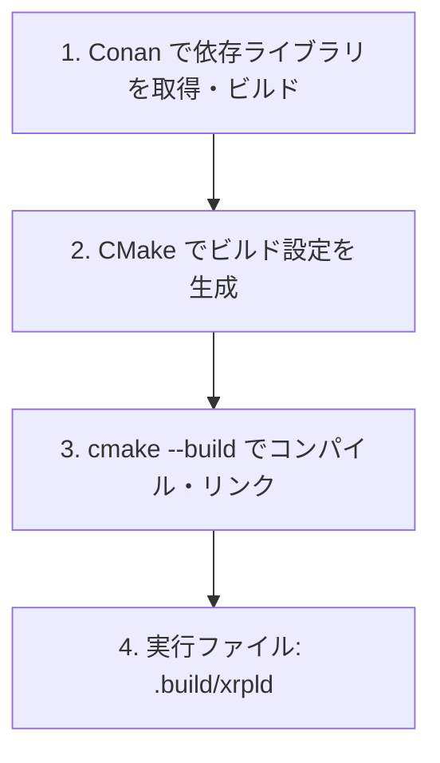

ソースコードが用意できたら、実際にビルドしてみましょう。xrpldはCMakeとConanを使ったビルドシステムを採用しています。

:::note[実行ファイル名について]
リポジトリ名は `rippled` ですが、ビルドされる実行ファイルの名前は **`xrpld`**（XRP Ledger Daemon）です。
:::

## ビルドの全体フロー



:::note[ステップ 1〜4 はすべて `.build/` 内で実行します]
ステップ 1 で `cd .build` した後は、**ビルド完了まで `.build/` ディレクトリに留まったまま**コマンドを実行します。
```
xrpld-test/       ← git clone したルート
└── .build/       ← ここで全コマンドを実行
```
:::

## ステップ 1: ビルドディレクトリを作成

`xrpld-test` のルートディレクトリで実行します：

```bash
# xrpld-test/ で実行
mkdir .build
cd .build
# 以降はすべて xrpld-test/.build/ 内で実行
```

## ステップ 2: 依存ライブラリの取得

`..` はルートの `conanfile.py` を指します（`.build/` の一つ上）。

```bash
# xrpld-test/.build/ で実行
conan install .. --output-folder . --build missing \
  --settings build_type=Release

conan install .. --output-folder . --build missing \
  --settings build_type=Debug
```

完了すると `.build/build/generators/conan_toolchain.cmake` が生成されます。

:::note[初回は時間がかかります]
初回実行時は、boostやopenssl等の依存ライブラリをソースからビルドします。環境によっては30分〜1時間以上かかることがあります。XRPLFのConanリモートを追加済みの場合はバイナリキャッシュが利用されて高速になります。
:::

:::caution[macOS で Apple Clang 17 以降を使う場合]
Xcode 16 以降の Apple Clang 17 では、`grpc` ビルドが失敗することがあります。[1-2. 環境構築](/xrpld/level1/setup/#apple-clang-17-以降を使う場合macos) の手順どおり、**このステップの前に** Conan プロファイルへ回避フラグを追加してください。
:::

:::tip[Release だけでも動きます]
学習目的でとりあえず動かしたい場合は `Release` だけ先に進めてOKです。デバッグシンボルが必要なときに `Debug` を追加します。
:::

## ステップ 3: CMakeの設定

`..` はルートの `CMakeLists.txt` を指します（`.build/` の一つ上）。

```bash
# xrpld-test/.build/ で実行
cmake -DCMAKE_TOOLCHAIN_FILE:FILEPATH=build/generators/conan_toolchain.cmake \
  -DCMAKE_BUILD_TYPE=Debug \
  -Dxrpld=ON \
  -Dtests=ON \
  ..
```

| オプション | 説明 |
|-----------|------|
| `-DCMAKE_TOOLCHAIN_FILE` | ステップ2で生成されたツールチェーンファイル |
| `-DCMAKE_BUILD_TYPE` | `Debug` または `Release` |
| `-Dxrpld=ON` | xrpldデーモンをビルドする |
| `-Dtests=ON` | テストをビルドする |

成功すると以下のような出力が出ます：

```
-- The CXX compiler identification is Clang 16.0.0
...
-- Build files have been written to: /path/to/xrpld-test/.build
```

## ステップ 4: ビルド実行

`.` は現在いる `.build/` ディレクトリを指します。

```bash
# xrpld-test/.build/ で実行
cmake --build . --parallel
```

:::tip[コア数を明示する場合]
`--parallel 4` のようにコア数を指定できます。メモリが少ない環境では制限することをお勧めします。
:::

ビルド完了まで20〜60分程度かかります。以下のような出力で完了です：

```
[100%] Linking CXX executable xrpld
```

## ビルド成功の確認

実行ファイルは `.build/` 内に生成されます。

```bash
# xrpld-test/.build/ で実行
./xrpld --version
```

以下のような出力が出ればビルド成功です：

```
xrpld version 3.2.0-rc2+...
Git commit hash: 47365f42203c53b723b3d209d8bcd760bf0c4822
Git build branch: develop
```

## ユニットテストの実行

```bash
./xrpld --unittest --unittest-jobs 4
```

数分後に `Passed X test cases` と表示されれば正常です。

## よくあるエラーと解決策

### `compiler.cppstd` エラー

```
ERROR: Package 'boost/...' can't be built with the current configuration
```

**解決策**: Conanプロファイルの `compiler.cppstd` を `20` に設定してください（[1-2. 環境構築](/xrpld/level1/setup/)参照）。

### メモリ不足でビルドが中断される

```
c++: fatal error: Killed signal terminated program cc1plus
```

**解決策**: 並列数を制限してください。

```bash
cmake --build . --parallel 2
```

### CMakeのバージョンエラー

```
CMake 3.22 or higher is required.
```

**解決策**: CMakeを更新してください。

```bash
# macOS
brew upgrade cmake

# Ubuntu
pip3 install cmake --upgrade
```

### `Error: could not load cache`

```
Error: could not load cache
```

**原因**: ステップ 3 の `cmake ... ..`（設定フェーズ）を実行していない状態で `cmake --build` を実行するとこのエラーが出ます。

**解決策**: ステップ 3 の cmake 設定を先に実行してください。

```bash
# xrpld-test/.build/ で実行
cmake -DCMAKE_TOOLCHAIN_FILE:FILEPATH=build/generators/conan_toolchain.cmake \
  -DCMAKE_BUILD_TYPE=Debug \
  -Dxrpld=ON \
  -Dtests=ON \
  ..
```

設定が完了すると `.build/CMakeCache.txt` が生成されます。その後に `cmake --build . --parallel` を実行してください。

### `build/generators/conan_toolchain.cmake` が見つからない

**解決策**: ステップ 2 の `conan install` が正常に完了しているか確認します。

```bash
ls build/generators/
# conan_toolchain.cmake が存在するはず
```

## 次のステップ

xrpldのビルドが成功しました。次はローカルネットワークを起動して動作を確認します。

