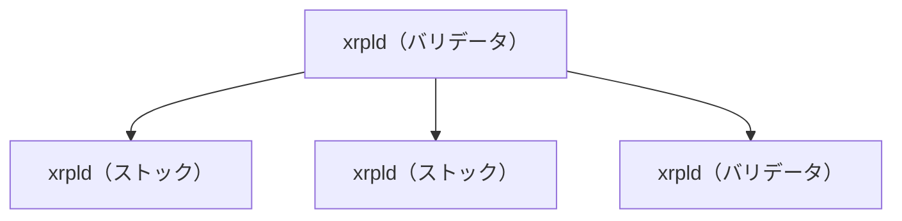
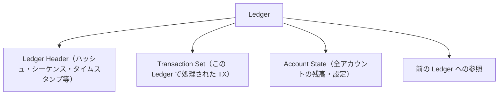

## XRP Ledger（XRPL）とは

XRP Ledger（XRPL）は、高速・低コスト・省エネルギーを特徴とする分散型台帳です。2011年に David Schwartz、Jed McCaleb、Arthur Britto らによって開発が始まり、2012年6月にローンチされました。現在は [XRP Ledger Foundation（XRPLF）](https://xrpl.foundation/) を中心に、オープンソースとして開発が続いています（公式の年表は [XRPL の歴史](https://xrpl.org/about/history) を参照）。

主な特徴：

- **決済の速さ**: トランザクションの確定に約3〜5秒
- **低コスト**: 送金手数料は約0.00001 XRP（数分の一セント）
- **省エネルギー**: Proof of Workを使わないコンセンサスアルゴリズム

## xrpldとは

`xrpld`（XRP Ledger Daemon）は、XRPLの**参照実装（リファレンス実装）**です。つまり、XRPLのルールを正式に実装したソフトウェアです。ソースコードは `rippled` リポジトリで管理されています。

```
src/xrpld/app/main/Main.cpp        # エントリポイント
src/xrpld/app/main/Application.cpp # 各サブシステムの初期化
```

XRPLネットワークは、世界中に分散した多数のxrpldノードで構成されています。各ノードは：

1. 他のノードとP2P通信でトランザクションを共有する
2. コンセンサスアルゴリズムで合意形成する
3. Ledger（台帳）を検証・保存する



### ノードの種類

| 種類 | 役割 |
|------|------|
| **ストックノード（Stock node）** | トランザクションの中継、履歴の保存 |
| **バリデータノード** | コンセンサスへの参加、Ledgerの検証 |

## コンセンサスアルゴリズム

xrpldはBitcoinのProof of Workとは異なる、**[XRP Ledger Consensus Protocol](https://xrpl.org/docs/concepts/consensus-protocol/)**（旧称: Ripple Consensus Protocol / RPCA）を実装しています。実装の中心は次のモジュールです（詳細は [4-1](/xrpld/level4/consensus/)）。

```
src/xrpld/consensus/Consensus.h
src/xrpld/app/consensus/RCLConsensus.h
```

基本的な流れ：

1. トランザクションがネットワークに送信される
2. 各バリデータが候補トランザクションの集合（候補セット）を交換する
3. 80%以上のバリデータが合意した候補セットが次のLedgerに含まれる
4. 新しいLedgerが確定（クローズ）する

:::note[PoWとの違い]
このコンセンサスはマイニングを必要としないため、エネルギー消費が非常に少ないのが特徴です。ただし、バリデータと UNL の選択に依存する設計です。
:::

## Ledgerの構造

XRPLのLedgerは以下の要素で構成されます：



各Ledgerには**シーケンス番号**があり、ジェネシスLedger（Ledger 1）から連続して積み重なっています。

## 主要なトランザクション種別

xrpldは多くのトランザクション種別をサポートしています。よく使うものを挙げます：

| トランザクション | 説明 |
|-----------------|------|
| `Payment` | XRPまたはトークンの送金 |
| `OfferCreate` | 分散型取引所（DEX）への注文 |
| `TrustSet` | トークンの受け取り設定 |
| `AccountSet` | アカウント設定の変更 |
| `EscrowCreate` | エスクロー（条件付き送金）の作成 |

## 次のステップ

XRPLとxrpldの全体像がつかめたら、実際に開発環境を構築しましょう。

