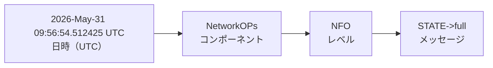
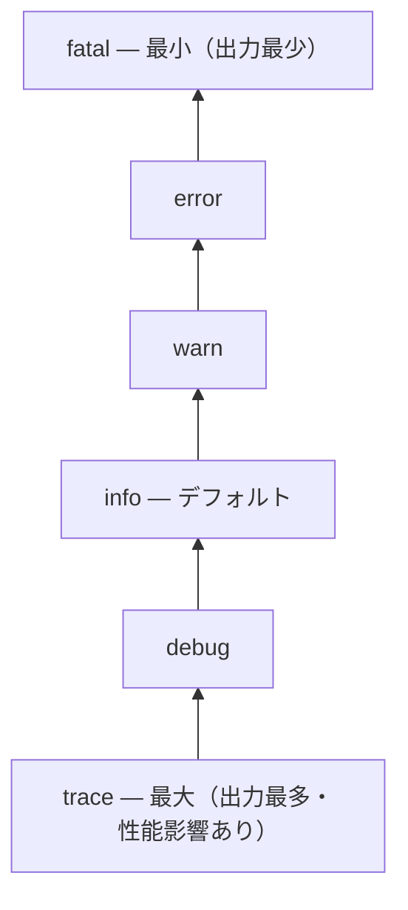

コードを読むだけでなく、実際に動かしながらログで挙動を確認することで理解が深まります。xrpldには強力なログシステムが組み込まれています。

## ログシステムの概要

xrpldのログは **Beast Journal** というライブラリが担当します。

```
include/xrpl/beast/utility/Journal.h
```

ログフォーマットは以下の通りです：



ログレベルとその略称（ログ中の表記）：

| レベル | ログ中の表記 | 用途 |
|--------|------------|------|
| `trace` | `TRC` | 最も詳細。ループ内の処理、関数の出入り等 |
| `debug` | `DBG` | 開発時のデバッグ情報 |
| `info` | `NFO` | 通常動作のマイルストーン（起動完了・Ledger確定等） |
| `warn` | `WRN` | 注意が必要だが処理は継続できる状態 |
| `error` | `ERR` | 処理が失敗した（リトライや回復の余地あり） |
| `fatal` | `FTL` | 致命的エラー（プロセス停止レベル） |

レベルは**包含関係**になっています。たとえば `warn` に設定すると `warn`・`error`・`fatal` のみが出力され、`info` 以下は抑制されます。



:::caution[trace / debug は本番環境で使わない]
`trace` や `debug` は出力量が非常に多く、ディスク使用量の急増やパフォーマンス低下を引き起こします。ローカル開発環境のみで使用してください。
:::

## ログの設定

`xrpld.cfg` でパーティションごとにログレベルを設定できます：

```ini
# xrpld.cfg
[rpc_startup]
{ "command": "log_level", "severity": "debug" }
```

または起動後に RPC で動的に変更できます：

```bash
# 全体を debug レベルに
./xrpld --conf ../localnet/xrpld.cfg log_level debug

# 特定パーティションだけ
./xrpld --conf ../localnet/xrpld.cfg log_level trace Application
```

主なパーティション名：

| パーティション | 対応コンポーネント |
|-------------|----------------|
| `Application` | アプリ全体の起動・初期化 |
| `LedgerMaster` | Ledger の管理 |
| `NetworkOPs` | ネットワーク操作 |
| `Overlay` | P2P ネットワーク |
| `Consensus` | コンセンサス処理 |
| `TransactionAcquire` | トランザクションの取得 |
| `TxQ` | トランザクションキュー |

## コードの中のログを読む

ソースコード中のログ出力を見ることで、どこで何が起きているかがわかります。`JLOG` マクロは `Journal.h` で定義されています。

```
include/xrpl/beast/utility/Journal.h
src/libxrpl/tx/Transactor.cpp
```

```cpp
// src/libxrpl/tx/Transactor.cpp

auto const result = ctx_.tx.checkSign(flags, ctx_.app.config());
if (result != tesSUCCESS)
{
    JLOG(j_.debug())
        << "applyTransaction: Invalid signature: " << result;
    return result;
}
```

`JLOG` マクロの使い方：

```cpp
// Journal オブジェクト（通常は j_ メンバ変数）を使う
JLOG(j_.trace()) << "詳細メッセージ: " << someValue;
JLOG(j_.debug()) << "デバッグ: tx=" << tx.getTransactionID();
JLOG(j_.warn())  << "警告: 残高不足 balance=" << balance;
JLOG(j_.error()) << "エラー: " << result;
```

## デバッグログを有効にして動作を追う

実際にトランザクション処理をログで追ってみましょう。

### 手順

**1. スタンドアロンモードで起動（debug ビルド推奨）**

```bash
./xrpld --conf ../localnet/xrpld.cfg --standalone
```

**2. Transactor 周辺のログを有効化**

```bash
./xrpld --conf ../localnet/xrpld.cfg log_level trace NetworkOPs
```

**3. トランザクションを送信してログを観察**

```bash
# 別ターミナルでログを監視
tail -f ../localnet/debug.log | grep -i "transaction\|apply\|payment"
```

### 観察できること

Payment トランザクションを送信すると、以下のようなログが流れます：

```
2026-May-31 09:56:54.649458 UTC NetworkOPs:NFO Consensus time for #3 with LCL DC1496C...
2026-May-31 09:56:54.529114 UTC LedgerMaster:DBG Ledger 2 accepted :DC1496CB...
```

## デバッガ（lldb/gdb）を使う

Debug ビルドであればデバッガを使ったステップ実行も可能です。

```bash
# macOS: lldb を使う
lldb ./xrpld

# ブレークポイントを設定
(lldb) breakpoint set --name "Payment::doApply"

# 実行
(lldb) run --conf ../localnet/xrpld.cfg --standalone

# ブレークポイントで止まったら
(lldb) bt        # バックトレース
(lldb) frame variable  # ローカル変数を確認
(lldb) next      # 次の行へ
(lldb) step      # 関数の中へ
```

:::caution[Debug ビルドで試す]
デバッガはDebugビルド（`--settings build_type=Debug`）でビルドした場合のみ有効です。Releaseビルドは最適化で変数が消えることがあります。
:::

## ログを使ったコード理解の実践

### 演習: Payment の流れをログで追う

これはコード理解のための一時的な観察用変更です。実装の挙動を変える練習は Level 5 で扱うので、ここではログを入れて流れを見たら、差分を残さず戻す前提で進めます。

1. `src/libxrpl/tx/Transactor.cpp` を開く
2. `apply()` メソッドの各ステップに `JLOG(j_.debug()) << "Step: ...";` を追加
3. リビルド（`cmake --build . --parallel`）してテストを実行
4. ログ出力を確認

```cpp
// src/libxrpl/tx/Transactor.cpp
NotTEC
Transactor::checkValid()
{
    JLOG(j_.debug()) << "checkValid: starting for tx "
                     << ctx_.tx.getTransactionID();

    auto const result = ctx_.tx.checkSign(flags, ctx_.app.config());
    JLOG(j_.debug()) << "checkValid: signature check result = " << result;

    ...
}
```

### テスト実行時のログ出力

ユニットテスト実行時にもログを確認できます：

```bash
# ログレベルを上げてユニットテスト実行
./xrpld --unittest Payment --unittest-log-level=debug 2>&1 | less
```

## よく使うデバッグのパターン

### 1. SLE の内容を出力する

```cpp
// SLE の全フィールドを JSON で出力
auto sle = view.read(keylet::account(accountID));
if (sle)
    JLOG(j_.debug()) << "AccountRoot: " << sle->getJson(JsonOptions::none);
```

### 2. STAmount を出力する

```cpp
STAmount amount = ctx_.tx.getFieldAmount(sfAmount);
JLOG(j_.debug()) << "Amount: " << to_string(amount);
```

### 3. AccountID を出力する

```cpp
AccountID const& account = ctx_.tx.getAccountID(sfAccount);
JLOG(j_.debug()) << "Account: " << toBase58(account);
```

## ここまでにできるようになったこと

- [x] xrpldのアーキテクチャと各モジュールの役割を説明できる
- [x] トランザクションが処理される全体フローを追える
- [x] Ledgerのデータ構造（SHAMap・SLE）を理解している
- [x] テストを読んで、新しいテストを書ける
- [x] ログとデバッガでコードの動作を追える

## 次のステップ

仕上げに、クライアントからの要求がどう振り分けられるかを [RPC/WebSocket APIの処理を追う](/xrpld/level2/rpc-api/) で確認すると、コードの全体像がさらにつながります。読み終えたら Level 3 に進み、実際に GitHub 上でコントリビューションする方法を学びましょう。

