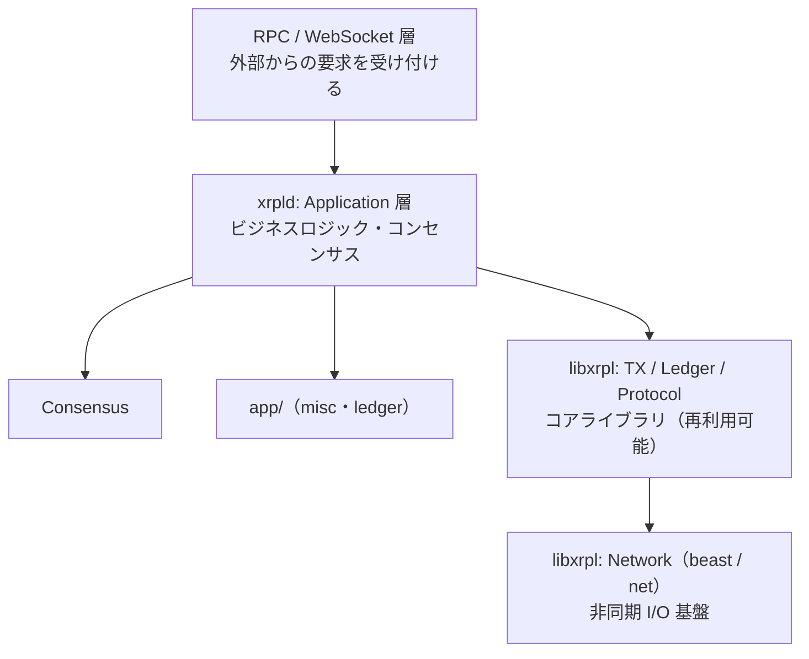
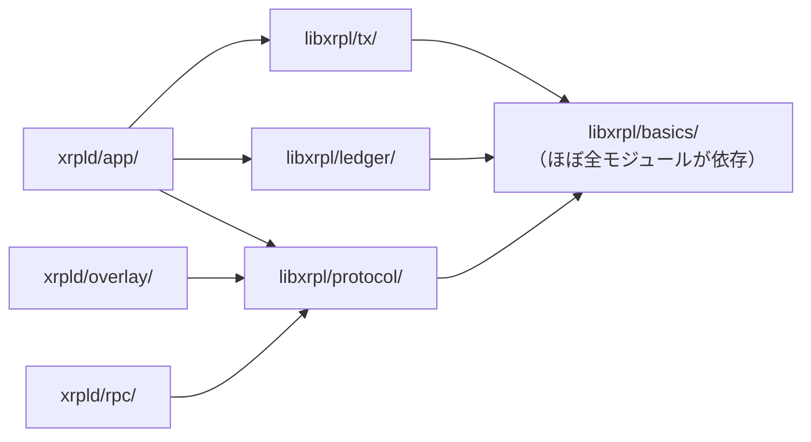

Level 1 でコードベースの概要を眺めました。Level 2 ではより深く、各モジュールの**責務と依存関係**を理解していきます。

## Level 2のゴール

Level 2では、コードを「全部読む」のではなく、主要な処理をたどる入口を作ります。終えるころには、次のことを説明できれば十分です。

- `src/libxrpl/` と `src/xrpld/` の役割の違い
- トランザクションがRPCから `Transactor` に届く大まかな流れ
- Ledgerを読む/変更するコードの入口
- テストやログを使って挙動を確認する方法

:::note[ソースパスの表記]
以降、実装の根拠として `include/xrpl/...`（公開ヘッダ）と `src/libxrpl/...`・`src/xrpld/...`（実装）を示します。パスは [XRPLF/rippled](https://github.com/XRPLF/rippled) リポジトリルートからの相対パスです。
:::

## アーキテクチャの大まかな層構造



## リポジトリの全体構成

```
rippled/
├── include/xrpl/  # libxrpl の公開ヘッダ（.h）
├── src/
│   ├── libxrpl/   # XRPLコアライブラリの実装（.cpp）
│   ├── xrpld/     # デーモン（ネットワーク・コンセンサス・RPC）
│   ├── test/      # ユニットテスト
│   └── tests/     # 統合テスト
└── docs/          # 設計ドキュメント・ビルド手順
```

:::caution[ヘッダと実装の場所が分かれている]
`libxrpl` は**公開ヘッダ（`.h`）が `include/xrpl/` 配下**、**実装（`.cpp`）が `src/libxrpl/` 配下**に置かれています。たとえば `TER` は宣言が `include/xrpl/protocol/TER.h`、定義が `src/libxrpl/protocol/TER.cpp` です。一方、デーモン側の `src/xrpld/` はヘッダと実装が同じディレクトリにまとまっています。
:::

## `src/libxrpl/` の詳細

ライブラリとして切り出されたコアロジックです。`xrpld` デーモンだけでなく、他のプロジェクトからも利用できます。公開 API の入口は `include/xrpl/` です。

```
include/xrpl/          # 公開ヘッダ（libxrpl）
src/libxrpl/           # 実装（.cpp）
```

```
libxrpl/
├── basics/         # 基本ユーティリティ（ハッシュ・時刻・ログ等）
├── beast/          # 非同期I/O基盤（Boost.Asioのラッパー）
├── conditions/     # Crypto-Conditions（署名条件）
├── core/           # 設定・ジョブキュー等のコアサービス
├── crypto/         # 暗号処理（ed25519, secp256k1）
├── json/           # JSON パーサ・シリアライザ
├── ledger/         # Ledger 読み書きインターフェース（ReadView/ApplyView）
├── net/            # HTTP/WebSocket クライアント
├── nodestore/      # Ledger データの永続化（NuDB/RocksDB）
├── protocol/       # プロトコル型・フォーマット定義・シリアライズ
├── protocol_autogen/ # 自動生成されたプロトコルコード
├── rdb/            # SQLite アクセス層
├── resource/       # レート制限・リソース管理
├── server/         # HTTP/WebSocket サーバー
├── shamap/         # SHAMap（Ledger の状態ツリー）
└── tx/             # トランザクション処理
    ├── Transactor.cpp      # 全TX共通の基底クラス
    ├── apply.cpp           # Ledger への適用エントリポイント
    └── transactors/        # 各TX種別の実装（カテゴリ別）
        ├── account/        # AccountSet, SetRegularKey 等
        ├── bridge/         # XChainBridge（クロスチェーン）
        ├── check/          # CheckCreate/Cash/Cancel
        ├── credentials/    # Credential 系
        ├── delegate/       # Delegate 系
        ├── dex/            # OfferCreate/Cancel（DEX）
        ├── did/            # DID（分散型 ID）
        ├── escrow/         # EscrowCreate/Finish/Cancel
        ├── lending/        # Lending 系
        ├── nft/            # NFTokenMint/Burn 等
        ├── oracle/         # Price Oracle
        ├── payment/        # Payment（送金）
        ├── payment_channel/ # PaymentChannel 系
        ├── permissioned_domain/ # パーミッション付きドメイン
        ├── system/         # Genesis, SetFee 等
        ├── token/          # Token 系
        └── vault/          # Vault
```

## `src/xrpld/` の詳細

デーモンプロセスとして動作するコードです。`libxrpl` を使ってネットワーク・コンセンサス・RPCを提供します。プロセスのエントリポイントは次です。

```
src/xrpld/app/main/Main.cpp
src/xrpld/app/main/Application.h
src/xrpld/app/main/Application.cpp
```

```
xrpld/
├── app/
│   ├── consensus/     # XRPL固有のコンセンサス実装（RCLConsensus）
│   ├── ledger/        # LedgerMaster・InboundLedgers・OpenLedger
│   ├── main/          # Application クラス・エントリポイント（Main.cpp）
│   ├── misc/          # AmendmentTable, FeeVote, NetworkOPs, TxQ 等
│   └── rdb/           # SQLite 操作
├── consensus/         # コンセンサスエンジン（汎用・テンプレート設計）
├── core/              # Config・TimeKeeper 等
├── overlay/           # P2Pオーバーレイネットワーク（ピア管理・メッセージ転送）
├── peerfinder/        # ピア探索アルゴリズム
├── perflog/           # パフォーマンスログ
├── rpc/               # RPC ハンドラ（submit, account_info 等）
└── shamap/            # SHAMap のデーモン側実装
```

:::tip[なぜ libxrpl と xrpld に分けたのか]
`libxrpl` はプロトコルのコアロジックを独立したライブラリとして提供します。これにより：
- 他のプロジェクト（ウォレット・ツール等）が同じコアを再利用できる
- デーモン固有のコードとプロトコルのコードを分離してテストしやすくなる
:::

## 依存関係の方向



**上位層は下位層に依存し、下位層は上位層を知らない**という原則です。

## 重要なファイルのクイックリファレンス

| 何を知りたいか | 見るべきファイル |
|-------------|----------------|
| TX処理の共通フロー | `src/libxrpl/tx/Transactor.cpp`（ヘッダは `include/xrpl/tx/Transactor.h`） |
| Payment の実装 | `src/libxrpl/tx/transactors/payment/` |
| Ledger への apply | `src/libxrpl/tx/apply.cpp` |
| TER 結果コード | `include/xrpl/protocol/TER.h` |
| アメンドメント一覧 | `include/xrpl/protocol/Feature.h` |
| Ledger エントリ定義 | `include/xrpl/protocol/LedgerFormats.h` |
| ピア通信 | `src/xrpld/overlay/` |
| RPC ハンドラ | `src/xrpld/rpc/handlers/`（カテゴリ別サブディレクトリ） |
| コンセンサス | `src/xrpld/consensus/` |
| コーディング規約 | `docs/CodingStyle.md` |

## 次のステップ

全体像をつかんだら、最も重要な処理フローであるトランザクション処理を深く追っていきましょう。

