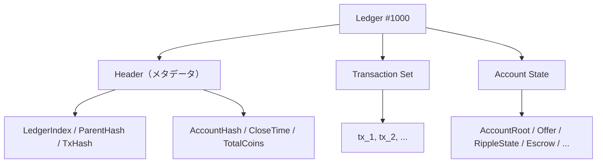
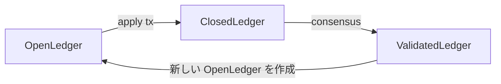

XRP Ledger の核心は「Ledger」です。このページでは、Ledger の構造、データのストレージ、そして xrpld がどのように管理するかを解説します。

## Ledger とは何か

Ledger は「ある時点における XRPL の完全な状態のスナップショット」です。



各 Ledger は**前の Ledger のハッシュ**を持つため、Ledger #1 から現在まで連鎖しています（ブロックチェーンと同様の構造）。

## SHAMap — Ledger のデータ構造

Account State と Transaction Set は **SHAMap** というデータ構造で保持されます。

```
include/xrpl/shamap/SHAMap.h
src/libxrpl/shamap/SHAMap.cpp
```

SHAMap はマークルパトリシアトライ（Merkle Patricia Trie）に似た構造です：

```
        Root Hash
       /          \
  Inner Node    Inner Node
   /    \          /   \
Leaf    Leaf    Leaf   Leaf
(Account A) (Account B) ...
```

特徴：
- ツリー全体の**ルートハッシュ**が一意に状態を表す
- 任意のエントリの**存在証明**をO(log N)で生成できる
- 差分（追加・更新・削除）を効率的に計算できる

ルートハッシュが Ledger Header の `AccountHash` として記録されます。

`Ledger` オブジェクトは state 用と transaction 用の2つの SHAMap を保持します。

```
include/xrpl/ledger/Ledger.h
src/libxrpl/ledger/Ledger.cpp
```

## Ledger エントリ（Account State の要素）

Account State に格納される各エントリを **SLE（Serialized Ledger Entry）** と呼びます。型ごとのフィールド定義はマクロから生成されます。

```
include/xrpl/protocol/LedgerFormats.h
include/xrpl/protocol/detail/ledger_entries.macro
src/libxrpl/protocol/InnerObjectFormats.cpp
```

主な SLE の種類：

| SLE タイプ | 説明 |
|-----------|------|
| `AccountRoot` | アカウントの残高・シーケンス番号・設定 |
| `RippleState` | 2アカウント間のトラストライン（IOU残高） |
| `Offer` | DEX の未約定注文 |
| `Escrow` | エスクロー |
| `PayChannel` | Payment Channel |
| `NFTokenPage` | NFT の保有情報 |
| `AMM` | 自動マーケットメーカー |

### AccountRoot の構造

AccountRoot のフィールド定義は `ledger_entries.macro` から生成されます。

```
include/xrpl/protocol/detail/ledger_entries.macro
```

```cpp
// include/xrpl/protocol/detail/ledger_entries.macro

sfAccount          // アカウントID
sfBalance          // XRP 残高（dropsで表現）
sfSequence         // 次のトランザクションのシーケンス番号
sfOwnerCount       // 保有する Ledger オブジェクト数
sfFlags            // 各種フラグ
sfRegularKey       // レギュラーキー（任意）
sfDomain           // ドメイン（任意）
```

## ReadView と ApplyView

Ledger へのアクセスは必ずビューインターフェース経由で行います。`doApply()` 内では `ApplyView` が渡され、読み取り専用の検証では `ReadView` が使われます。

```
include/xrpl/ledger/ReadView.h
include/xrpl/ledger/ApplyView.h
src/libxrpl/ledger/View.cpp
include/xrpl/ledger/View.h
```

### ReadView — 読み取り専用

```cpp
// include/xrpl/ledger/ReadView.h
class ReadView {
    // SLE を取得する
    std::shared_ptr<SLE const> read(Keylet const& k) const;

    // アカウントの XRP 残高を取得
    XRPAmount balanceHook(...) const;

    // Ledger のメタ情報
    LedgerInfo const& info() const;
};
```

### ApplyView — 変更可能

```cpp
// include/xrpl/ledger/ApplyView.h
class ApplyView : public ReadView {
    // SLE を新規作成
    std::shared_ptr<SLE> insert(std::shared_ptr<SLE> const& sle);

    // SLE を更新（変更前に peek() で取得）
    std::shared_ptr<SLE> peek(Keylet const& k);

    // SLE を削除
    void erase(std::shared_ptr<SLE> const& sle);
};
```

### 実際のコードでの使用例

残高の移動は Ledger ヘルパにまとめられており、各 Transactor から呼ばれます。

```
src/libxrpl/ledger/View.cpp
include/xrpl/ledger/View.h
```

Payment 処理の例：

```cpp
// src/libxrpl/ledger/View.cpp
void
transferXRP(
    ApplyView& view,
    AccountID const& from,
    AccountID const& to,
    XRPAmount amount,
    beast::Journal j)
{
    // 送金元の SLE を取得（変更可能）
    auto const sle = view.peek(keylet::account(from));

    // 残高を減らす
    sle->setFieldAmount(sfBalance, sle->getFieldAmount(sfBalance) - amount);
    view.update(sle);

    // 送金先の SLE も同様に更新
    ...
}
```

## Keylet — Ledger エントリの検索キー

SLE を取得するには **Keylet** を使います。

```
include/xrpl/protocol/Keylet.h
include/xrpl/protocol/Indexes.h
```

```cpp
// アカウントの AccountRoot を取得する Keylet
auto k = keylet::account(accountID);

// Offer を取得する Keylet
auto k = keylet::offer(accountID, sequence);

// Keylet を使って SLE を取得
auto sle = view.read(keylet::account(accountID));
```

## OpenLedger と ClosedLedger

```
src/xrpld/app/ledger/OpenLedger.h
src/xrpld/app/ledger/LedgerMaster.h
```

| 種類 | 状態 | 特徴 |
|------|------|------|
| **OpenLedger** | 変更可能 | トランザクションを受け付け中 |
| **ClosedLedger** | 変更不可 | コンセンサス前に一時的にクローズ |
| **ValidatedLedger** | 確定 | コンセンサス完了・永続化済み |



## LedgerMaster

Ledger の保持と取得を管理するのが `LedgerMaster` です。

```
src/xrpld/app/ledger/LedgerMaster.h
src/xrpld/app/ledger/detail/LedgerMaster.cpp
```

```cpp
// src/xrpld/app/ledger/LedgerMaster.h

class LedgerMaster {
    // 最新の確定 Ledger を取得
    std::shared_ptr<Ledger const> getValidatedLedger();

    // 指定シーケンス番号の Ledger を取得
    std::shared_ptr<Ledger const> getLedgerBySeq(std::uint32_t index);

    // Ledger を検証・追加
    bool storeLedger(std::shared_ptr<Ledger const> ledger);
};
```

## 実際に Ledger を操作するコードを読む

以下のファイルを順に読むと理解が深まります：

1. `src/libxrpl/protocol/LedgerFormats.cpp` — SLE フォーマットの定義一覧
2. `src/libxrpl/ledger/View.cpp` — `transferXRP` など、よく使われる操作
3. `src/libxrpl/tx/transactors/payment/` — 実際に View を使う例
4. `include/xrpl/shamap/SHAMap.h` — SHAMap のインターフェース

:::tip[Keylet を起点に読む]
`keylet::account()` や `keylet::offer()` のような Keylet の定義を `include/xrpl/protocol/Indexes.h` で確認することで、どんな Ledger エントリが存在するかを網羅的に把握できます。
:::

## 次のステップ

Ledger のデータ構造を理解できました。次は、これらの挙動を保証する [テストの読み方・書き方](/xrpld/level2/testing/) を学びます。テストコードは「コードの正しい使い方」を示す最良のドキュメントです。

