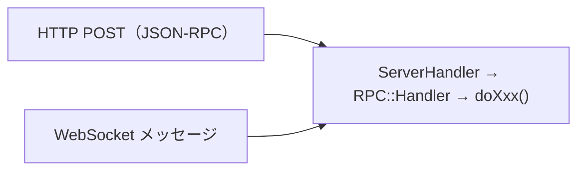

[2-2. トランザクション処理の流れ](/xrpld/level2/tx-flow/) では `submit` を起点に書き込み系の流れを追いました。このページでは、API リクエスト全般が **どのハンドラに振り分けられ、どんな前提条件でチェックされるか** という共通の仕組みを見ていきます。`account_info` のような読み取り系コマンドの追い方も身につきます。

## 2つの入り口：JSON-RPC と WebSocket

xrpld は同じコマンド群を2つの経路で受け付けます。



どちらの経路でも、最終的には同じハンドラ関数（`doAccountInfo` など）が呼ばれます。HTTP/WebSocket の受け口と RPC ディスパッチは次です。

```
src/xrpld/rpc/ServerHandler.h
src/xrpld/rpc/detail/ServerHandler.cpp
src/xrpld/rpc/detail/Handler.cpp      # kHandlerArray（コマンド登録）
src/xrpld/rpc/detail/RPCCall.cpp
```

:::note[WebSocket はサブスクリプションも扱える]
JSON-RPC は1リクエスト1レスポンスですが、WebSocket は `subscribe` による継続的な通知（Ledgerクローズ・トランザクション・板情報など）も受け取れます。サブスクリプション系は `src/xrpld/rpc/handlers/subscribe/` にあります。
:::

## ハンドラの登録テーブル

どのコマンド名がどの関数に対応するかは、`src/xrpld/rpc/detail/Handler.cpp` の `kHandlerArray` で一覧定義されています。

```cpp
// src/xrpld/rpc/detail/Handler.cpp
Handler const kHandlerArray[]{
    {.name = "account_info",
     .valueMethod = byRef(&doAccountInfo),
     .role = Role::USER,
     .condition = Condition::NoCondition},

    {.name = "submit",
     .valueMethod = byRef(&doSubmit),
     .role = Role::USER,
     .condition = Condition::NeedsCurrentLedger},

    {.name = "tx",
     .valueMethod = byRef(&doTxJson),
     .role = Role::USER,
     .condition = Condition::NeedsNetworkConnection},
    // ...
};
```

各エントリは「コマンド名・ハンドラ関数・必要な権限・前提条件」を結びつけています。新しい RPC コマンドを追加するときは、この配列に1行追加するのが出発点です。

## Role — 必要な権限

`Role` は、そのコマンドを誰が呼べるかを表します。

```
src/xrpld/rpc/Role.h
src/xrpld/rpc/detail/Role.cpp
```

```cpp
// src/xrpld/rpc/Role.h
enum class Role { GUEST, USER, IDENTIFIED, ADMIN, PROXY, FORBID };
```

| Role | 意味 |
|------|------|
| `GUEST` | 制限付きの一般アクセス |
| `USER` | 通常のクライアント（多くの読み取り・送信系） |
| `ADMIN` | 管理者専用（ノード制御・鍵生成など） |
| `FORBID` | 拒否 |

たとえばノードを停止する `stop` のような管理コマンドは `ADMIN`、`account_info` のような参照系は `USER` です。`admin` 系ハンドラは `src/xrpld/rpc/handlers/admin/` にまとまっています。

## Condition — 実行に必要な前提

`Condition` は、コマンド実行前にノードが満たすべき状態を表すフラグです。

```
src/xrpld/rpc/detail/Handler.h
src/xrpld/rpc/detail/Handler.cpp
```

```cpp
// src/xrpld/rpc/detail/Handler.h
enum class Condition {
    NoCondition = 0,
    NeedsNetworkConnection = 1,
    NeedsCurrentLedger = 1 << 1,
    NeedsClosedLedger = 1 << 2,
};
```

| Condition | 意味 |
|-----------|------|
| `NoCondition` | 前提なし（スタンドアロンでも動く） |
| `NeedsNetworkConnection` | ネットワークに接続していること |
| `NeedsCurrentLedger` | 現在進行中の Ledger が必要 |
| `NeedsClosedLedger` | 確定済みの Ledger が必要 |

`submit` が `NeedsCurrentLedger` を要求するのは、トランザクションを **進行中の OpenLedger** に適用する必要があるからです。条件を満たさないノード（同期中など）に投げると、ここで弾かれます。

## 読み取り系ハンドラを追う：`account_info`

書き込み系の `submit` に対して、読み取り系の代表が `account_info` です。

```
src/xrpld/rpc/handlers/account/AccountInfo.cpp
```

```cpp
// src/xrpld/rpc/handlers/account/AccountInfo.cpp
Json::Value
doAccountInfo(RPC::JsonContext& context)
{
    // 1. パラメータ（account / ledger_index 等）を読み取る
    // 2. 対象 Ledger を取得
    // 3. keylet::account() で AccountRoot SLE を read()
    // 4. 結果を JSON に組み立てて返す
}
```

ポイントは、書き込みを伴わないため `ReadView::read()` だけを使い、[2-3. Ledgerの仕組み](/xrpld/level2/ledger/) で見た `ApplyView` は使わないことです。`Condition::NoCondition` なので、過去の確定 Ledger を指定すれば同期していなくても応答できます。

## ハンドラがカテゴリ別に整理されている

`src/xrpld/rpc/handlers/` は、コマンドの種類ごとにサブディレクトリへ分割されています。

| ディレクトリ | 主なコマンド |
|-------------|------------|
| `account/` | `account_info`, `account_lines`, `account_tx` 等 |
| `ledger/` | `ledger`, `ledger_entry`, `ledger_data` 等 |
| `transaction/` | `submit`, `tx`, `transaction_entry` 等 |
| `orderbook/` | `book_offers`, `path_find`, `amm_info` 等 |
| `server_info/` | `server_info`, `fee`, `feature` 等 |
| `subscribe/` | `subscribe`, `unsubscribe` |
| `admin/` | 管理者向けコマンド |
| `utility/` | `ping`, `random` |

:::tip[コマンドからコードへたどる近道]
あるコマンドの実装を探すときは、まず `kHandlerArray` でコマンド名を `grep` してハンドラ関数名（`doXxx`）を特定し、その関数を再度 `grep` すると実装ファイルに到達できます。
:::

```bash
# 例: book_offers の実装を探す
grep -n "book_offers" src/xrpld/rpc/detail/Handler.cpp
grep -rn "doBookOffers" src/xrpld/rpc/handlers/
```

## 実際にコードを読む練習

1. `src/xrpld/rpc/detail/Handler.cpp` の `kHandlerArray` を眺め、コマンドと role/condition の対応を確認する
2. `src/xrpld/rpc/handlers/account/AccountInfo.cpp` を開き、`read()` でSLEを取得する流れを追う
3. `src/xrpld/rpc/handlers/transaction/Submit.cpp` を [2-2](/xrpld/level2/tx-flow/) の内容と照らし合わせて読む

## 次のステップ

API リクエストの振り分けの仕組みが理解できました。これで Level 2 は完了です。Level 3 に進み、実際の [good first issueの探し方](/xrpld/level3/first-issue/) からコントリビューションを始めましょう。
