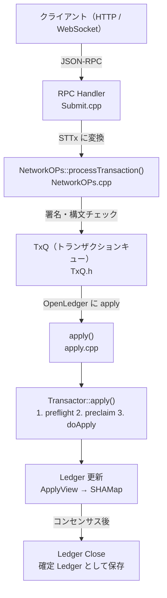
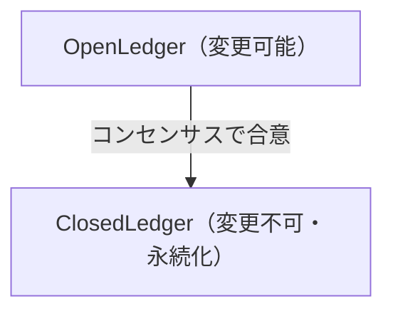

xrpld がトランザクションを受信してから Ledger に反映されるまで、コードの中でどのような処理が行われるのかを追っていきます。

## 全体フロー



## ステップ 1: RPC でトランザクションを受け取る

`submit` RPCコマンドのハンドラを見てみましょう。RPCハンドラはカテゴリ別のサブディレクトリに整理されており、トランザクション系は `transaction/` 配下にあります。

```
src/xrpld/rpc/handlers/transaction/Submit.cpp
```

```cpp
// src/xrpld/rpc/handlers/transaction/Submit.cpp
Json::Value doSubmit(RPC::JsonContext& context)
{
    // 1. 16進数のトランザクションデータをデコード
    auto [stx, error] = RPC::Transaction::parseSTTx(...);
    if (error)
        return error;

    // 2. NetworkOPs に渡す
    auto result = context.netOps.processTransaction(
        stx, isAdmin, local, failHard, ...
    );
    ...
}
```

`STTx` はシリアライズされたトランザクションを表すオブジェクトです（`ST` = Serialized Type）。

## ステップ 2: NetworkOPs での検証

`NetworkOPs::processTransaction()` では最初の検証が行われます。通過後は `TxQ` へ渡され、OpenLedger への適用がスケジュールされます。

```
src/xrpld/app/misc/NetworkOPs.cpp
src/xrpld/app/misc/TxQ.h
src/xrpld/app/misc/detail/TxQ.cpp
```

主に以下の検証をします：

1. **署名の検証** — トランザクションに付いた署名が正しいか
2. **手数料の確認** — 最低手数料（base fee）以上かどうか
3. **重複確認** — 同じトランザクションが既に処理されていないか

## ステップ 3: Transactor の3段階検証

最も重要な部分です。`apply()` が Transactor を生成し、3段階を順に呼び出します。

```
src/libxrpl/tx/apply.cpp
src/libxrpl/tx/Transactor.cpp
include/xrpl/tx/Transactor.h
```

### preflight — 静的チェック（Ledger不要）

```cpp
static NotTEC preflight(PreflightContext const& ctx)
```

Ledger の状態を参照せず、トランザクション自体の構造をチェックします：

- 必須フィールドの存在確認
- フィールドの値の範囲チェック
- 手数料フォーマットの検証

**Ledger を参照しないため、高速に実行できます。**

### preclaim — Ledger 参照チェック

```cpp
static TER preclaim(PreclaimContext const& ctx)
```

Ledger の現在の状態を参照して検証します：

- 送信者アカウントの存在確認
- シーケンス番号の確認（リプレイ攻撃防止）
- 残高が手数料を払えるか確認
- アカウントの権限確認

### doApply — Ledger への適用

```cpp
TER doApply()
```

実際に Ledger を変更します。各トランザクション種別のサブクラスがこのメソッドをオーバーライドします。適用後に、トランザクション固有のInvariantフックとプロトコル共通のInvariant Checkが走ります（[6-4](/xrpld/level6/invariants/) 参照）。

```
src/libxrpl/tx/Transactor.cpp   # Transactor::apply(), checkInvariants()
```

## Transactor のクラス階層

トランザクション種別ごとの実装は `transactors/` 以下にカテゴリ別に配置されています。ファクトリ登録は `detail/applySteps.cpp` 付近を確認してください。

```
include/xrpl/tx/Transactor.h
src/libxrpl/tx/applySteps.cpp
```

```
Transactor (基底クラス: src/libxrpl/tx/Transactor.cpp)
│
├── src/libxrpl/tx/transactors/payment/   Payment
├── src/libxrpl/tx/transactors/dex/       OfferCreate, OfferCancel
├── src/libxrpl/tx/transactors/escrow/    EscrowCreate/Finish/Cancel
├── src/libxrpl/tx/transactors/nft/       NFTokenMint 等
├── src/libxrpl/tx/transactors/check/     CheckCreate 等
└── ...（その他多数）
```

すべてのトランザクション種別は `Transactor` を継承し、少なくとも `preflight()` と `doApply()` を実装します。`preclaim()` は必要な場合だけ定義し、不要なトランザクションは基底クラスの既定実装を使います。現在の `Transactor` では、トランザクション固有Invariant用の `visitInvariantEntry()` と `finalizeInvariants()` も実装します。

## TER コード

`doApply()` の戻り値は `TER`（Transaction Execution Result）です。

```
include/xrpl/protocol/TER.h
```

主なコード：

| コード | 意味 |
|--------|------|
| `tesSUCCESS` | 成功 |
| `tecNO_DST` | 送金先アカウントが存在しない |
| `tecINSUFFICIENT_FUNDS` | 残高不足 |
| `temBAD_AMOUNT` | 不正な金額 |
| `tefPAST_SEQ` | シーケンス番号が古い |

プレフィックスで処理の段階がわかります：

| プレフィックス | 意味 |
|-------------|------|
| `tec` | Ledger に記録されるが失敗（手数料は消費される） |
| `tef` | Ledger に記録されない失敗 |
| `tel` | ローカルエラー（ノード設定等） |
| `tem` | マルフォーム（構造的エラー） |
| `ter` | リトライ可能なエラー |
| `tes` | 成功 |

## コンセンサス後の確定

トランザクションが OpenLedger に適用された後、コンセンサスで合意が取れると Ledger が**クローズ**されます。OpenLedger の管理と確定 Ledger の保存は次の実装です。

```
src/xrpld/app/ledger/OpenLedger.h
src/xrpld/app/ledger/LedgerMaster.h
src/xrpld/app/ledger/detail/LedgerMaster.cpp
```



## 実際にコードを読む練習

以下のファイルを順番に開いて読んでみてください：

1. `src/libxrpl/tx/Transactor.cpp` — `apply()` メソッドを読む
2. `src/libxrpl/tx/transactors/payment/` — Payment の `doApply()` を読む
3. `include/xrpl/protocol/TER.h` — 結果コードの一覧を眺める
4. `src/test/app/AccountSet_test.cpp` — テストコードで使い方を確認

:::tip[grep で呼び出し元を追う]
`doApply` がどこから呼ばれているかを追うには：
```bash
grep -r "doApply" src/libxrpl/tx/
```
コードの流れをグラフのようにたどる習慣をつけましょう。
:::

## 次のステップ

トランザクションがどのように処理されるかを追えました。次は、その処理対象である [Ledger の仕組み](/xrpld/level2/ledger/) を理解しましょう。`doApply()` が実際に書き換えているデータ構造の正体がわかります。

