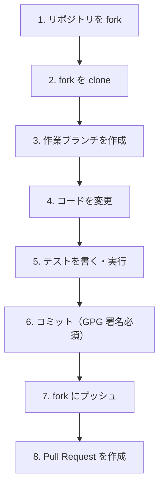

issue が決まったら、実際にコードを書いて PR を出すまでの流れを解説します。

## 全体の流れ



## Step 1: リポジトリを Fork する

GitHub 上で `https://github.com/XRPLF/rippled` を開き、右上の **Fork** ボタンを押します。これで自分のアカウント配下にコピーが作成されます。

## Step 2: Fork を Clone する

```bash
git clone https://github.com/<your-username>/rippled.git xrpld-test
cd xrpld-test

# upstream（本家）を追加
git remote add upstream https://github.com/XRPLF/rippled.git
git remote -v
# origin   https://github.com/<your-username>/rippled.git (fetch)
# upstream https://github.com/XRPLF/rippled.git (fetch)
```

::::note[Level 1で clone 済みの場合]
Level 1で `https://github.com/XRPLF/rippled.git` を `xrpld-test` に clone 済みなら、同じリポジトリをもう一度 clone しなくても構いません。その場合は、自分の fork を `origin`、本家を `upstream` として設定し直します。

```bash
cd xrpld-test
git remote rename origin upstream
git remote add origin https://github.com/<your-username>/rippled.git
git remote -v
```

以降は `upstream/develop` から作業ブランチを作り、自分の fork である `origin` に push します。
::::

## Step 3: 作業ブランチを作る

必ず `develop` ブランチから作業ブランチを切ります（`master` や `release` ではありません）。

```bash
# upstream の最新を取得
git fetch upstream
git checkout -b <your-username>/fix-something upstream/develop
```

### ブランチ命名規則

外部コントリビューターの場合、ブランチ名は以下の形式を使います：

```
<GitHub username>/<説明>
```

例：
```
nabesan/fix-payment-path-bug
nabesan/add-escrow-test
nabesan/docs-update-build-guide
```

:::note[リポジトリへの write アクセスがある場合]
書き込み権限を持つ開発者は `XLS-0033d/feature-name` や `ripple/fix-something` の形式も使えます。外部コントリビューターは `<username>/...` 形式を使います。
:::

## Step 4: コードを変更する

作業ブランチで変更を加えます。変更は**1つの論理的な目的**に集中させましょう。

```bash
# 変更したファイルを確認
git status
git diff
```

## Step 5: テストを書いて実行する

**すべての変更にはテストが必要です。**

```bash
cd .build

# 関連するテストだけ実行（高速）
./xrpld --unittest Payment

# 全テストを実行
./xrpld --unittest --unittest-jobs 4
```

テストが通ることを確認してからコミットします。

## Step 6: コミットする

### GPG 署名の設定

xrpld への全コミットは **GPG 署名が必須**です。未設定の場合は先にセットアップしてください。

```bash
# GPG キーの確認
gpg --list-secret-keys --keyid-format=long

# Git に GPG キーを設定
git config --global user.signingkey <YOUR_KEY_ID>
git config --global commit.gpgsign true
```

### コミットメッセージの書き方

xrpld は [CONTRIBUTING.md の Good commit messages](https://github.com/XRPLF/rippled/blob/develop/CONTRIBUTING.md#good-commit-messages) に沿ったコミットメッセージを推奨しています。一般的な書き方として [How to Write a Git Commit Message](https://cbea.ms/git-commit/) も参考になります。

```
件名（50文字以内、命令形、末尾にピリオドなし）

本文（72文字で折り返し）
何をしたか・なぜしたかを説明する。
どうやったかではなく、何を・なぜを書く。

Closes #1234
```

**良い例：**
```
Fix Payment path calculation for IOU-to-IOU transfer

When both source and destination currencies are IOUs from different
issuers, the path finder incorrectly excluded direct paths through
the order book. This caused some valid payments to fail with
tecPATH_DRY.

Closes #5678
```

**悪い例：**
```
fix bug
updated payment.cpp
WIP
```

### 命令形の書き方

件名は「このコミットを適用すると、\_\_\_する」と読めるように書きます。

| 悪い例 | 良い例 |
|--------|--------|
| `Fixed the bug` | `Fix the bug` |
| `Adding test` | `Add test for Payment edge case` |
| `Changes to escrow` | `Update EscrowFinish to handle expired condition` |

### コミット実行

```bash
git add <変更ファイル>
git commit -S -m "Fix Payment path calculation for IOU-to-IOU transfer"
# -S で GPG 署名を付ける（commit.gpgsign=true なら省略可）
```

### コミットの粒度

- 関連する変更は1つのコミットにまとめる（開発途中の `WIP` コミットは後でsquash）
- 複数の目的が混在する場合は分割する

## Step 7: Fork にプッシュする

```bash
git push origin <your-username>/fix-something
```

## upstream との同期

作業中に `develop` が進んだ場合は、rebase で同期します：

```bash
git fetch upstream
git rebase upstream/develop
```

:::caution[マージコミットは使わない]
`git merge upstream/develop` ではなく、`git rebase upstream/develop` を使ってください。マージコミットが混入すると PR がレビューしにくくなります。
:::

## pre-commit フックの設定（推奨）

xrpld では `clang-format` や `clang-tidy` のチェックを pre-commit フックとして設定できます。

```bash
pip3 install pre-commit
pre-commit install
```

コミット時に自動でフォーマットチェックが走るようになります。
