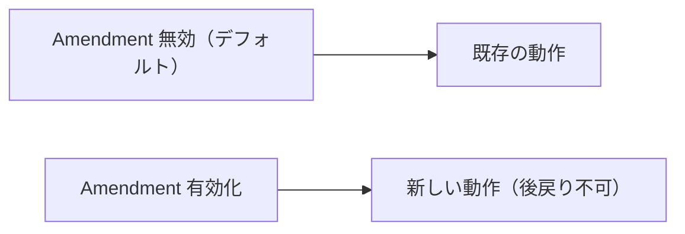
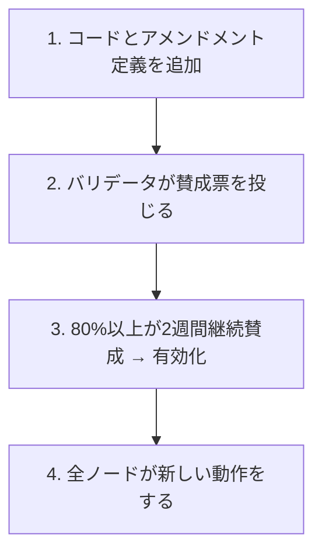

XRP Ledger は稼働中のネットワークを停止せずに新機能を追加する仕組みとして **Amendment（アメンドメント）** を持っています。

## アメンドメントとは

アメンドメントは「機能フラグ」です。コードの中に新旧2つの実装を共存させておき、ネットワーク全体でフラグが有効化されたときだけ新しい動作をします。



一度有効化されたアメンドメントは無効化できません。これにより、バリデータが大多数を占める前に機能が有効化されてフォークが起きるのを防ぎます。

## 有効化のプロセス



:::note[2週間のウィンドウ]
「80%以上が2週間継続して賛成」という条件は、ネットワーク参加者が準備する猶予を与えるためです。準備が整っていないノードはアップグレードするか、ネットワークから外れるかを選べます。
:::

## コードでの定義

アメンドメントの一覧は `XRPL_FEATURE` / `XRPL_FIX` マクロで定義され、`Feature.h` がそれを取り込んで `featureXxx` 定数を生成します。

```
include/xrpl/protocol/detail/features.macro
include/xrpl/protocol/Feature.h
src/libxrpl/protocol/Feature.cpp
```

```cpp
// include/xrpl/protocol/detail/features.macro
//
// XRPL_FEATURE(名前, Supported::Yes|No, VoteBehavior::DefaultYes|No)

XRPL_FEATURE(LendingProtocol,  Supported::Yes, VoteBehavior::DefaultNo)
XRPL_FEATURE(MPTokensV2,       Supported::No,  VoteBehavior::DefaultNo)
```

このマクロから `include/xrpl/protocol/Feature.h` 側で `featureLendingProtocol` のような定数（アメンドメントの一意なID = `uint256`）が自動生成されます。

引数の意味：

| 引数 | 種類 | 意味 |
|-----|------|------|
| `Supported::Yes` / `No` | サポート状態 | このビルドが機能を実装済みか |
| `VoteBehavior::DefaultYes` | 投票 | デフォルトで賛成票を投じる |
| `VoteBehavior::DefaultNo` | 投票 | デフォルトで反対票を投じる（新しい・慎重なもの） |

実際の起動ログで見た `will be down voted by default` は `DefaultNo` のアメンドメントです。

## トランザクションコードでの使い方

アメンドメントガードは `ApplyView` の `rules()` を通じてチェックします。`Rules` の実装は次にあります。

```
include/xrpl/protocol/Rules.h
include/xrpl/ledger/ApplyView.h
```

```cpp
// トランザクション処理コードの中での例
TER
SomeTransactor::doApply()
{
    // アメンドメントが有効な場合のみ新しい処理
    if (ctx_.view().rules().enabled(featureMyNewFeature))
    {
        // 新機能の処理
        return tesSUCCESS;
    }

    // 旧来の処理
    return doLegacyApply();
}
```

新しいトランザクションタイプ全体をアメンドメントで無効化する場合は、`preflight()` で直接 `ctx.rules.enabled(...)` を見るのではなく、Transactor に `checkExtraFeatures()` を定義します。`Transactor` の共通処理がこれを呼び、無効時に `temDISABLED` として扱います。

```cpp
static bool
MyTransactor::checkExtraFeatures(PreflightContext const& ctx)
{
    return ctx.rules.enabled(featureMyNewFeature);
}
```

既存トランザクションの一部挙動だけを切り替える場合は、`doApply()` やLedger参照が必要な段階で `ctx_.view().rules().enabled(...)` を見て、新旧の処理を分けます。

## AmendmentTable

どのアメンドメントが現在有効かを管理するのが `AmendmentTable` です。有効/無効の判定は `Rules` 経由でトランザクション処理から参照されます。

```
include/xrpl/ledger/AmendmentTable.h
src/xrpld/app/misc/AmendmentTableImpl.h
include/xrpl/protocol/Rules.h
```

```cpp
// include/xrpl/ledger/AmendmentTable.h

// アメンドメントが有効かを確認
bool isEnabled(uint256 const& amendment) const;

// 現在の投票状況を取得
AmendmentSet getAmendments(Rules const& rules) const;
```

## Ledger 上のアメンドメント状態

有効化されたアメンドメントの一覧は Ledger の特別なエントリ `ltAMENDMENTS` に記録されます。フォーマット定義は `LedgerFormats` にあります。

```
include/xrpl/protocol/LedgerFormats.h
include/xrpl/protocol/detail/ledger_entries.macro
```

```bash
# 現在有効なアメンドメントの確認
./xrpld --conf ../localnet/xrpld.cfg ledger_entry amendments
```

## 新しいアメンドメントを追加するには

新しいトランザクション種別や動作変更を加えるときの手順：

::::note[ここでは仕組みを理解する]
このページでは、アメンドメントがなぜ必要か、Ledger上でどう管理されるかを理解することが目的です。実際に新機能をアメンドメントで守る実装手順は、Level 6 の [アメンドメントを定義して機能を追加する](/xrpld/level6/amendment-dev/) で扱います。
::::

**1. features.macro にアメンドメントを定義する**

```cpp
// include/xrpl/protocol/detail/features.macro
// 新しいアメンドメントは一覧の先頭に追加する
XRPL_FEATURE(MyFeature, Supported::Yes, VoteBehavior::DefaultNo)
```

**2. トランザクションコードにガードを追加する**

```cpp
if (ctx_.view().rules().enabled(featureMyFeature))
{
    // 新しい動作
}
```

**3. アメンドメント有効・無効の両方でテストを書く**

```cpp
// テストで有効・無効を切り替える
Env env(*this, supported_amendments() | featureMyFeature);  // 有効
Env env(*this, supported_amendments() - featureMyFeature);  // 無効
```

**4. XLS 提案を作成して議論する**

コードを書く前に `https://github.com/XRPLF/XRPL-Standards` で XLS 提案として議論することが推奨されます。

## 実際に有効化されたアメンドメントを調べる

起動ログに表示される各アメンドメントの状態：

```
Amendments:DBG Amendment xxx (PayChan) is supported and will be up voted by default
Amendments:DBG Amendment yyy (AMM)     is supported and will be down voted by default
```

全アメンドメントの定義は以下で確認できます：

```bash
grep -E "XRPL_FEATURE|XRPL_FIX" include/xrpl/protocol/detail/features.macro | less
```
