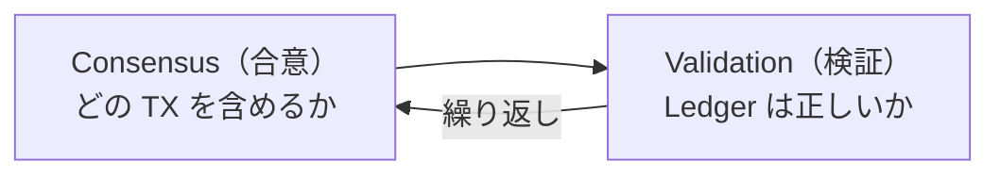
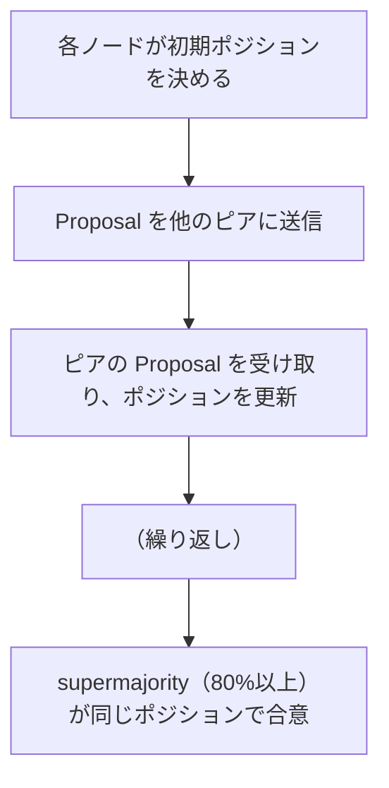

XRP Ledger のコンセンサスアルゴリズムは、PoW（Proof of Work）とは根本的に異なるアプローチを取ります。このページでは、アルゴリズムの仕組みと、それがどのようにコードに実装されているかを解説します。

::::note[Level 4の読み方]
Level 4は深掘り用です。コンセンサス、P2P、SHAMap、NodeStoreを一度に完全理解する必要はありません。最初は「どの責務がどのファイルにあるか」をつかみ、Level 5の実践に進んだ後で、必要になったテーマへ戻って読む進め方でも大丈夫です。
::::

## Level 4のゴール

このLevelでは、実装をすぐ変更するよりも、`xrpld` の根幹にある仕組みを読む入口を作ります。

- コンセンサスとValidationの役割を区別できる
- P2P、SHAMap、NodeStoreの担当範囲を説明できる
- アメンドメントがなぜ安全な機能追加に必要か説明できる
- 性能やストレージの変更を最初のPRにしない理由を理解する

## コンセンサスと検証の分離

XRP Ledger では2つのフェーズが交互に繰り返されます：



- **Consensus（合意）**: 次のLedgerに含めるトランザクションの集合を決める
- **Validation（検証）**: 生成されたLedgerが正しいかを確認し、広める

Validation の収集・管理は次のモジュールにあります。

```
src/xrpld/consensus/Validations.h
src/xrpld/app/consensus/RCLValidations.cpp
```

## 3つのフェーズ

コンセンサスエンジン本体と XRPL への接続点は次のファイルです。

```
src/xrpld/consensus/Consensus.h
src/xrpld/app/consensus/RCLConsensus.h
src/xrpld/app/misc/NetworkOPs.cpp   # ラウンド開始・Ledger クローズのトリガ
```

### フェーズ 1: Open（オープン）

トランザクションを受け付けている期間です。以下の条件でクローズに移行します：

- 前回ラウンドのピアの過半数がすでにクローズしている
- `ledgerIdleInterval`（15秒）経過してトランザクションがない
- `ledgerMinConsensus`（1.95秒）以上経過している

```cpp
// src/xrpld/consensus/ConsensusParms.h
// Ledger が idle 状態でクローズするまでの時間
std::chrono::milliseconds ledgerIdleInterval{15000};

// コンセンサスフェーズの最小待機時間
std::chrono::milliseconds ledgerMinConsensus{1950};
```

### フェーズ 2: Establish（確立）

ピアと提案（Proposal）を交換し、合意形成を行うフェーズです。提案の送受信は `Consensus::peerProposal()`、動的しきい値は `ConsensusParms` に定義されています。

```
src/xrpld/consensus/Consensus.h
src/xrpld/consensus/ConsensusParms.h
```



#### 動的なしきい値（Avalanche）

合意が遅れると、徐々に要求するしきい値が上がります：

| 状態 | 経過時間 | 必要な同意率 |
|------|---------|------------|
| `Init` | 0% | 50% |
| `Mid` | 50% | 65% |
| `Late` | 85% | 70% |
| `Stuck` | 200% | 95% |

これにより、合意できない状態が長引くほど「今の多数意見に従う」ようになります。

#### Disputed Transaction（議論中のトランザクション）

自分のポジションとピアのポジションが異なるトランザクションを **DisputedTx** と呼びます。

```
src/xrpld/consensus/DisputedTx.h
```

ピアの中で `minConsensusPct`（80%）以上が含めようとしていれば自分も含める、逆に80%以上が除外しようとしていれば除外する、という判断を繰り返します。

### フェーズ 3: Accept（受理）

合意したトランザクション集合をもとに新しい Ledger を生成します。受理後のラウンド開始は `Consensus::startRound()` から行われます。

```
src/xrpld/consensus/Consensus.h
src/xrpld/app/ledger/detail/LedgerMaster.cpp
```

このフェーズではコンセンサスの内部状態を変更しません。完了後に `startRound()` を呼んで次のラウンドを開始します。

## コンセンサスのモード

ノードは4つのモードのいずれかで動作します。モード列挙と遷移は `Consensus.h` 内で定義されています。

```
src/xrpld/consensus/Consensus.h
```

| モード | 状態 |
|--------|------|
| `Proposing` | 提案を送信する（バリデータ） |
| `Observing` | 提案を送信しない（ストックノード） |
| `WrongLedger` | 正しいLCLを持っていない。ピアに要求中 |
| `SwitchedLedger` | WrongLedgerから復帰した直後 |

スタンドアロンモードで起動するとコンセンサスは行われません（ログに `Running in standalone mode` と表示されます）。

## クローズ時刻の合意

各ノードは独立してクローズ時刻を計算し、「クローズ時刻の解像度」の倍数に丸めます。

```cpp
// src/xrpld/consensus/ConsensusParms.h
// クローズ時刻を丸める粒度（1秒単位）
std::chrono::seconds ledgerGRANULARITY{1};
```

これにより、ノード間でクロックが完全に同期していなくても共通のクローズ時刻に合意できます。合意がうまくいくと解像度が細かくなり、失敗すると粗くなります。

## テンプレート設計（CRTP）

`Consensus.h` はCRTP（Curiously Recurring Template Pattern）で設計されており、XRPLのアプリケーションコードには依存しません。

```cpp
// src/xrpld/consensus/Consensus.h
template <class Adaptor>
class Consensus
{
    // Adaptor はアプリ固有の実装を提供する
    // - ledger の取得
    // - トランザクションの取得
    // - proposal の送受信
    // - validation の処理
};
```

XRPLの固有実装は `RCLConsensus`（`src/xrpld/app/consensus/`）が `Adaptor` として提供します。これにより、コンセンサスのロジックをXRPLに依存せずテストできます。

## 主要パラメータ一覧

```
src/xrpld/consensus/ConsensusParms.h
```

| パラメータ | 値 | 説明 |
|-----------|-----|------|
| `minConsensusPct` | 80% | コンセンサス成立の最小同意率 |
| `ledgerIdleInterval` | 15秒 | アイドル時のクローズ待機時間 |
| `ledgerMinConsensus` | 1.95秒 | コンセンサスフェーズの最短時間 |
| `ledgerMaxConsensus` | 15秒 | 遅れたノードの最大待機時間 |
| `ledgerAbandonConsensus` | 120秒 | ラウンドの最大継続時間 |
| `proposeFRESHNESS` | 20秒 | 提案の有効期間 |
| `proposeINTERVAL` | 12秒 | 新しい提案の生成間隔 |
| `avCtConsensusPct` | 75% | クローズ時刻の合意しきい値 |

## コードを読む手順

1. `src/xrpld/consensus/Consensus.h` — `timerEntry()`, `peerProposal()` を読む
2. `src/xrpld/consensus/ConsensusParms.h` — 全パラメータを確認
3. `src/xrpld/consensus/DisputedTx.h` — 議論中TXの管理
4. `src/xrpld/app/consensus/RCLConsensus.h` — XRPL固有のAdaptor実装
5. `src/xrpld/consensus/Validations.h` — Validation の収集・管理
