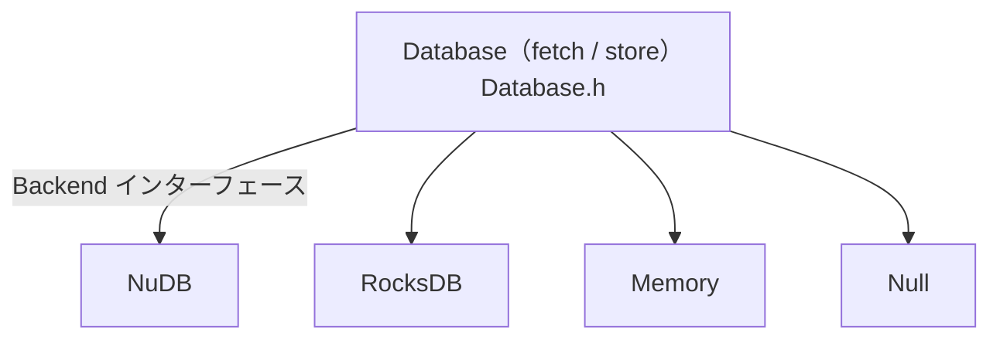
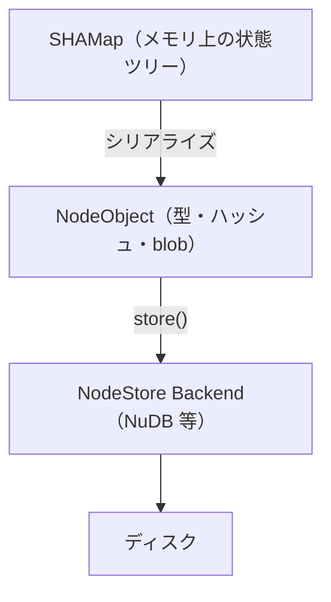

[4-4. SHAMapの詳細](/xrpld/level4/shamap/) で見た SHAMap のノードは、最終的にディスクへ永続化されます。その永続化を担うのが **NodeStore** です。このページでは、xrpld がどのようにデータを保存し、運用上どんな選択肢があるのかを理解します。

## NodeObject — 保存の最小単位

NodeStore が扱う基本単位は **NodeObject** です。`NodeObject` は「型・ハッシュ・blob」からなるシンプルなオブジェクトで、ハッシュ（blobの256ビットハッシュ）で一意に識別されます。

```
include/xrpl/nodestore/NodeObject.h
```

型（`mType`）は4種類あります。

| 型 | 内容 |
|----|------|
| ledger | Ledger ヘッダ |
| transaction | 署名済みトランザクション |
| account node | Account State ツリーの SHAMap ノード |
| transaction node | Transaction ツリーの SHAMap ノード |

つまり、SHAMap の各ノードが NodeObject として key-value 形式で保存されます。**キー = ハッシュ、値 = シリアライズされたノード**という、追記中心のシンプルなストレージモデルです。

## NodeStore のアーキテクチャ

NodeStore はバックエンドを差し替え可能な設計になっています。



- **`Database`** — 上位から見たインターフェース（`fetch` / `store`）。キャッシュやバッチ書き込みもここで管理されます。
- **`Backend`** — 実際のストレージ実装の抽象。
- **Factory** — 設定で指定された名前から適切なバックエンドを生成します。

```
include/xrpl/nodestore/Database.h
include/xrpl/nodestore/Backend.h
include/xrpl/nodestore/NodeObject.h
src/libxrpl/nodestore/Database.cpp
```

各バックエンドの実装はここにあります。

```
src/libxrpl/nodestore/backend/
├── NuDBFactory.cpp     # NuDB（デフォルト・推奨）
├── RocksDBFactory.cpp  # RocksDB
├── MemoryFactory.cpp   # インメモリ（テスト用）
└── NullFactory.cpp     # 破棄（何も保存しない）
```

## NuDB と RocksDB

本番運用で使われるバックエンドは2つです。

| バックエンド | 特徴 |
|-------------|------|
| **NuDB** | Ripple が開発した追記専用 key-value ストア。**データ量が増えても速度が落ちない**のが最大の特徴。SSD 向け。現在の推奨 |
| **RocksDB** | 汎用 key-value ストア。データ量が増えると性能が低下する。SSD 以外でも動く代替肢 |

:::note[なぜ NuDB なのか]
NodeStore はほぼ「追記」と「ハッシュによるランダム読み取り」しか行いません。NuDB はこのアクセスパターンに特化することで、履歴が膨大になっても一定の速度を保てるように設計されています。汎用 DB の RocksDB は機能が豊富な分、大量データで性能劣化が起きやすくなります。
:::

## 設定ファイルでの指定

どのバックエンドを使うかは `xrpld.cfg` の `[node_db]` セクションで指定します。

```ini
[node_db]
type=NuDB
path=/var/lib/rippled/db/nudb
online_delete=512
advisory_delete=0
```

主なキー：

| キー | 意味 |
|------|------|
| `type` | バックエンド（`NuDB` / `RocksDB`） |
| `path` | データの保存先ディレクトリ |
| `online_delete` | 保持する Ledger 数（古いものを自動削除）。最小256 |
| `earliest_seq` | 保持を開始する最古のシーケンス番号 |
| `fast_load` | 起動時に最後の Ledger を先読みして起動を速くする |

:::tip[フルヒストリーと online_delete]
`online_delete` を設定すると古い Ledger が自動的に削除され、ディスク使用量を抑えられます（運用ノード向け）。全履歴を保持する「フルヒストリーノード」を運用する場合は `online_delete` を設定しません。ローカル検証では小さい値で十分です。
:::

## コードを読む入り口

```
include/xrpl/nodestore/README.md   # NodeStore の設計とベンチマーク
include/xrpl/nodestore/Database.h  # fetch/store の上位インターフェース
include/xrpl/nodestore/Backend.h   # バックエンドの抽象
src/libxrpl/nodestore/backend/NuDBFactory.cpp  # NuDB 実装
```

:::note[ベンチマークの参考資料]
リポジトリには `docs/NodeStoreRefactoringCaseStudy.pdf` があり、NodeStore のリファクタリングとパフォーマンス改善の事例が解説されています。ストレージ層のチューニングに興味があれば一読の価値があります。
:::

## SHAMap との関係をおさらい



読み取り時は逆順に、ハッシュをキーに NodeObject を `fetch` し、デシリアライズして SHAMap ノードを復元します。

## 次のステップ

ストレージ層まで理解できました。Level 4 ではコンセンサス・ネットワーク・ストレージという xrpld の根幹を見てきました。次の Level 5 では、既存トランザクションを題材に [ローカルでxrpldを変える準備](/xrpld/level5/preparation/) から、実際に手元で挙動を変える体験に進みます。
