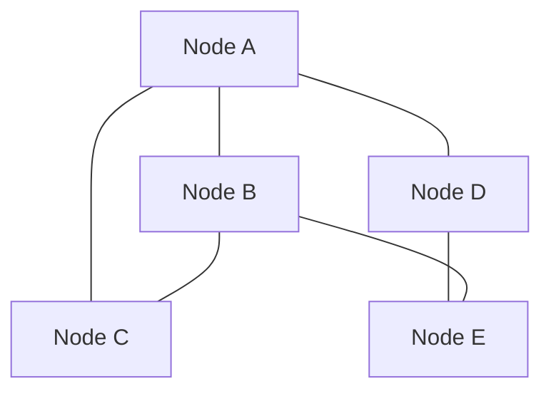
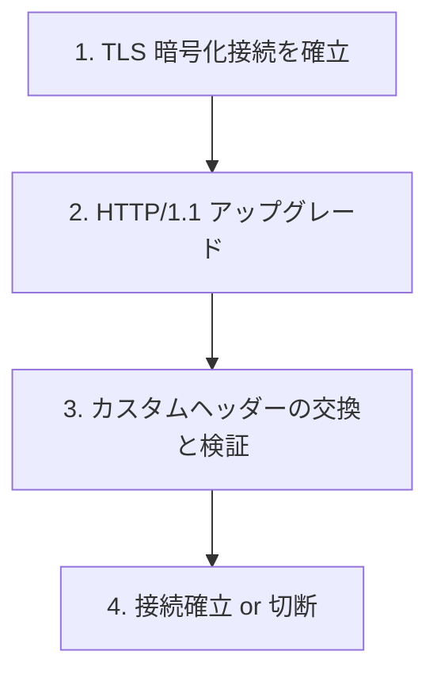

xrpld ノードは世界中のピアと TCP/IP 接続を維持し、トランザクションや Ledger データを交換します。このページでは、その仕組みをコードレベルで解説します。

## オーバーレイネットワークの構造

XRP Ledger のネットワークは**有向グラフ**として構成されます：



頂点: xrpld インスタンス / 辺: 永続的な TCP/IP 接続

各ノードは複数のピアと接続を維持します。単一のノードを落としてもネットワーク全体は影響を受けません（耐障害性）。P2P 通信の実装は `src/xrpld/overlay/` に集約されています。

## 実装の場所

```
src/xrpld/overlay/
├── Overlay.h          # ピア管理のインターフェース
├── Peer.h             # 個々のピア接続のインターフェース
├── Message.h          # P2P メッセージ型
├── PeerSet.h          # ピアの集合管理
├── Squelch.h          # メッセージの重複抑制
├── ReduceRelayCommon.h # リレー削減の共通ロジック
└── impl/
    ├── OverlayImpl.h/cpp  # Overlay の実装
    ├── PeerImp.h/cpp      # Peer の実装（最重要）
    └── ...
```

## 接続の確立: ハンドシェイク

ピア同士が接続するとき、以下の手順でハンドシェイクを行います：



ハンドシェイク処理の本体は `PeerImp` の実装にあります。仕様の詳細は同ディレクトリの README も参照してください。

```
src/xrpld/overlay/detail/PeerImp.cpp
src/xrpld/overlay/README.md
```

### ハンドシェイクのカスタムヘッダー

| ヘッダー | 必須 | 説明 |
|---------|------|------|
| `Public-Key` | 必須 | ノードの識別子（base58エンコードのsecp256k1公開鍵） |
| `Connect-As` | 必須 | 接続タイプ（現在は `peer` のみ） |
| `Session-Signature` | 必須 | TLSセッションへの署名（MITM攻撃防止） |
| `Network-ID` | 任意 | ネットワーク識別（mainnet=0, testnet=1） |
| `Network-Time` | 任意 | 時刻同期（20秒以上のずれで切断） |
| `Closed-Ledger` | 任意 | 現在のLedger状態 |

### セッション署名によるMITM防止

TLSの「Finished Message」を双方のノードが取り出し、自身の秘密鍵で署名してから相手に送ります。受け取った署名を公開鍵で検証し、一致しなければ中間者攻撃とみなして切断します。

```cpp
// src/xrpld/overlay/detail/PeerImp.cpp
// 1. TLS finished message を取得
auto const sharedValue = makeSharedValue(ssl_bundle_->stream);

// 2. 自分の秘密鍵で署名
auto const sig = signDigest(nodePrivateKey, sharedValue);

// 3. 相手の署名を検証
if (!verifyDigest(peerPublicKey, sharedValue, peerSig))
    fail("Session signature mismatch");
```

## メッセージの種類

ピア間のメッセージは **Protocol Buffers**（protobuf）でシリアライズされます。

メッセージ型は Protocol Buffers で定義され、オーバーレイ層では `Message.h` 経由で扱われます。

```
include/xrpl/proto/xrpl.proto
src/xrpld/overlay/Message.h
```

| メッセージ | 説明 |
|-----------|------|
| `TMTransaction` | トランザクションの転送 |
| `TMGetLedger` | Ledger データのリクエスト |
| `TMLedgerData` | Ledger データのレスポンス |
| `TMProposeSet` | コンセンサス提案の送信 |
| `TMValidation` | Ledger の検証情報 |
| `TMGetObjectByHash` | オブジェクト（SHAMap ノード等）の取得 |
| `TMPing` | 接続確認 |
| `TMManifest` | バリデータのキー更新情報 |

## Squelch: メッセージの重複抑制

同じトランザクションや検証情報が多数のピアから届くと、ネットワーク帯域が無駄になります。**Squelch** はこの重複を抑制する仕組みです。

```
src/xrpld/overlay/Squelch.h
```

仕組み：
1. ピアから同じメッセージを複数回受け取ると、重複を送ってきたピアを一時的に「抑制」する
2. 抑制されたピアへは「このメッセージは送らなくていい」と通知する
3. 一定時間後に抑制を解除する

## Reduce Relay: リレー削減

XRP Ledger では検証メッセージ（Validation）と Proposal の転送を最適化する仕組みがあります。共通ロジックと実装の入口は次のとおりです。

```
src/xrpld/overlay/ReduceRelayCommon.h
src/xrpld/overlay/detail/OverlayImpl.cpp
```

すべてのノードがすべてのメッセージを全ピアに転送すると、ネットワーク全体のトラフィックが O(N²) になります。Reduce Relay はこれを削減し、各バリデータのメッセージが少数の「選ばれたピア」だけを通じて広まるようにします。

## ピア探索: PeerFinder

新しいノードが起動したとき、どのピアに接続するかを決めるのが **PeerFinder** です。

```
src/xrpld/peerfinder/PeerfinderManager.h
src/xrpld/peerfinder/detail/PeerfinderConfig.cpp
```

主な動作：
1. 設定ファイルに書かれたブートストラップノードに接続
2. 接続先から他のノードのアドレスリストを取得（`TMEndpoints` メッセージ）
3. 適切なノードに接続して接続数を維持する

設定ファイルの例：
```ini
[ips]
r.ripple.com 51235     # Ripple 社の公開ノード
```

## コードを読む手順

1. `src/xrpld/overlay/Overlay.h` — インターフェースを確認
2. `src/xrpld/overlay/detail/PeerImp.cpp` — `onReadMessage()` でメッセージ受信処理を追う
3. `src/xrpld/overlay/detail/OverlayImpl.cpp` — `connect()` で接続確立を確認
4. `src/xrpld/overlay/README.md` — ハンドシェイクの詳細な仕様

:::tip[Wireshark で確認する]
ローカルでノードを複数起動してWiresharkでキャプチャすると、実際の TLS ハンドシェイクとメッセージのやり取りを観察できます（TLS なので内容は暗号化されていますが、接続確立のパターンは見えます）。
:::
