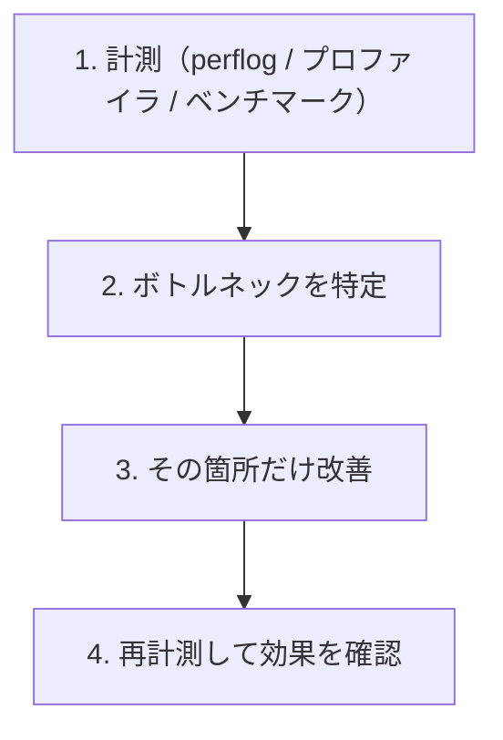

xrpld はネットワーク通信・コンセンサス・ストレージ I/O を並行して処理する高負荷なソフトウェアです。このページでは、パフォーマンスを支える内部の仕組みと、計測・チューニングの入り口を解説します。コントリビューションで性能に関わる変更を加えるとき、何を見るべきかの土台になります。

:::caution[最初は性能変更を避ける]
[3-1. good first issueの探し方](/xrpld/level3/first-issue/) でも触れたとおり、パフォーマンス最適化は影響範囲が広く、最初の issue には向きません。まずは「どう計測するか」「どこがボトルネックになりやすいか」を理解することを目標にしましょう。
:::

## JobQueue — 並行処理の心臓部

xrpld の多くの処理は **JobQueue** を通じて非同期に実行されます。ジョブの投入は各サブシステム（Overlay、LedgerMaster 等）から行われ、実装は `JobQueue` と `Job` 型で管理されます。

```
include/xrpl/core/JobQueue.h
include/xrpl/core/Job.h
src/libxrpl/core/detail/JobQueue.cpp
```

JobQueue は、種類（Job タイプ）ごとに優先度を持つジョブをワーカースレッドのプールで処理する仕組みです。トランザクションの検証、Ledger の取得、ピアからのメッセージ処理などが「ジョブ」として投入されます。

```
ジョブ投入 → [ JobQueue ] → ワーカースレッドプール → 実行
              （種類ごとに優先度）
```

ボトルネックを調べるときは、「どの種類のジョブが滞留しているか」を見ることが多くなります。

## ワーカースレッドの設定

スレッド数は `xrpld.cfg` で調整できます。

| 設定 | 役割 |
|------|------|
| `[workers]` | ピア・クライアントからの処理を担うスレッド数。既定はCPUスレッド数+2（スタンドアロンは1） |
| `[io_workers]` | 生の入出力（IO）を処理するスレッド数 |
| `[prefetch_workers]` | NodeStore の先読み用スレッド数 |

```ini
# xrpld.cfg の例
[workers]
6
```

:::tip[むやみに増やさない]
スレッドを増やせば速くなるとは限りません。CPU コア数を超えるとコンテキストスイッチが増えてかえって遅くなることもあります。既定値はマシンに応じて自動設定されるため、まずは既定のまま計測するのがおすすめです。
:::

## パフォーマンスログ（perflog）

xrpld には、ジョブやRPCの実行状況を記録する **perflog** という機能があります。

```
src/xrpld/perflog/detail/PerfLogImp.cpp
```

`xrpld.cfg` の `[perf]` セクションで有効化すると、ジョブの実行回数・待ち時間などが定期的にログファイルへ出力されます。

```ini
[perf]
perf_log=/var/log/xrpld/perf.log
```

このログを分析すると、どのジョブタイプがボトルネックになっているかを定量的に把握できます。

## メモリのプロファイリング

メモリ使用量やリークの調査には、`jemalloc` を使ったヒーププロファイリングが利用できます。リポジトリには `docs/HeapProfiling.md` もありますが、古い `scons` 時代の例を含むため、現在のCMake/Conanビルドでは `conanfile.py` とCMakeの `jemalloc` オプションも確認します。

```
docs/HeapProfiling.md
conanfile.py
cmake/XrplInterface.cmake
```

要点：

- Conan の `jemalloc` オプションを有効にして `jemalloc` 依存を入れる
- CMake 側の `jemalloc` 変数が有効になると `PROFILE_JEMALLOC` が定義される
- 実行中のプロセスからヒープのダンプを取得して解析する

:::note[Linux 向け]
ヒーププロファイリングは主に Linux でテストされています。xrpld と jemalloc の両方が動く環境であれば動作します。
:::

## 計測してから最適化する

パフォーマンス改善の鉄則は「推測せず、計測する」です。



:::tip[Release ビルドで計測する]
性能計測は必ず最適化が効いた `Release` ビルドで行います。`Debug` ビルドはアサーションや最適化無効化のため、本番とは大きく異なる特性になります。
:::

## ボトルネックになりやすい領域

| 領域 | 着目点 |
|------|--------|
| NodeStore I/O | ディスク速度・キャッシュヒット率（[4-6](/xrpld/level4/nodestore/) 参照） |
| SHAMap 操作 | ノードの探索・ハッシュ計算（[4-4](/xrpld/level4/shamap/) 参照） |
| シリアライズ | `STObject` のエンコード／デコード |
| JobQueue | 特定ジョブの滞留・優先度 |

## 次のステップ

パフォーマンスを支える仕組みと計測の考え方を理解しました。続いて、もう一つの基盤である [NodeStoreとストレージ層](/xrpld/level4/nodestore/) で、データがどう永続化されるかを見ていきましょう。
