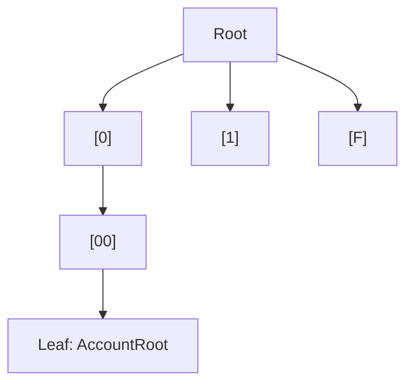
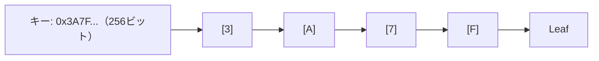
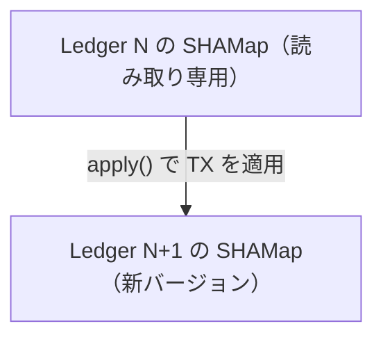

SHAMap は XRP Ledger のデータを格納するコアなデータ構造です。Ledger の Account State（アカウント状態）と Transaction Set（トランザクション集合）の両方が SHAMap として管理されます。

## SHAMap とは

SHAMap は**マークルパトリシアトライ（Merkle Patricia Trie）** に似た 16分木（radix-16 trie）です。



### 主な特徴

**ルートハッシュ**: ツリー全体の内容が1つのハッシュ（`uint256`）で表現されます。これが Ledger Header の `AccountHash` として記録されます。

**差分の効率的な計算**: 2つの SHAMap 間の差分（追加・変更・削除されたエントリ）を O(変更数 × log N) で計算できます。これにより Ledger 間の差分を高速に計算できます。

**証明の生成**: 特定のエントリの存在を O(log N) で証明できます（Merkle Proof）。

## ノードの種類

ヘッダは `include/xrpl/shamap/`、実装は `src/libxrpl/shamap/` に分かれています。

```
include/xrpl/shamap/ (ヘッダ) ＋ src/libxrpl/shamap/ (実装)
├── SHAMap.h / SHAMap.cpp          # メインのデータ構造
├── SHAMapItem.h                   # Leaf に格納されるデータ
├── SHAMapInnerNode.h / .cpp       # 内部ノード（16個の子を持つ）
├── SHAMapLeafNode.h / .cpp        # 葉ノード（実際のデータ）
└── SHAMapTreeNode.h / .cpp        # 内部・葉の共通基底
```

| ノード種別 | 説明 |
|-----------|------|
| `SHAMapInnerNode` | 16個の子（0〜F）を持つ内部ノード。各子のハッシュを保持 |
| `SHAMapLeafNode` | 実際のデータ（SLE や トランザクション）を格納する葉 |

内部ノードのハッシュ更新は次の実装を読むと Merkle 構造の核心が追えます。

```
include/xrpl/shamap/SHAMapInnerNode.h
src/libxrpl/shamap/SHAMapInnerNode.cpp
include/xrpl/shamap/SHAMapLeafNode.h
```

## キーと検索

各エントリは **256ビットのキー**（`uint256`）でインデックスされます。



Account State の場合、キーは `keylet::account(accountID).key` で得られます。

```cpp
// アカウントのキーを取得
auto const key = keylet::account(accountID).key;

// SHAMap から SLE を検索
auto const leaf = accountStateMap.findKey(key);
```

## SHAMap の種類

```cpp
// include/xrpl/shamap/SHAMap.h
enum class SHAMapType {
    TRANSACTION,  // Transaction Set（トランザクション集合）
    STATE,        // Account State（アカウント状態）
    FREE          // 汎用（テスト等）
};
```

## 操作の基本

```cpp
// include/xrpl/shamap/SHAMap.h

// エントリの追加
bool addItem(SHAMapNodeType type, SHAMapItem&& item);

// エントリの更新
bool updateGiveItem(SHAMapNodeType type, SHAMapItem&& item);

// エントリの削除
bool delItem(uint256 const& id);

// ルートハッシュの取得（Ledger Header に記録される値）
uint256 const& getHash() const;

// 2つの SHAMap の差分を計算
Delta delta(SHAMap const& other) const;
```

## Ledger での使われ方

Ledger は2つの SHAMap を持ちます：

```cpp
// include/xrpl/ledger/Ledger.h

class Ledger {
    // 1. Account State Map
    //    全アカウントの状態（AccountRoot, Offer, RippleState等）
    std::shared_ptr<SHAMap> stateMap_;

    // 2. Transaction Map
    //    このLedgerで処理されたトランザクション
    std::shared_ptr<SHAMap> txMap_;
};
```

## イミュータブルな設計

SHAMap はバージョン管理されており、変更は新しいバージョンとして記録されます：



古いバージョンは参照がある間はメモリに保持され、参照がなくなるとGCされます。これにより過去の Ledger を効率的に参照できます。

## Delta（差分）の活用

2つの Ledger 間の差分を計算することで、何が変わったかを高速に把握できます：

```cpp
// Ledger N と Ledger N+1 の差分を計算
auto const delta = ledgerN1.stateMap().delta(ledgerN.stateMap());

for (auto const& [key, change] : delta)
{
    if (change.first && !change.second)
        // 削除されたエントリ
    else if (!change.first && change.second)
        // 追加されたエントリ
    else
        // 変更されたエントリ
}
```

## コードを読む手順

1. `include/xrpl/shamap/SHAMap.h` — インターフェース全体を確認
2. `include/xrpl/shamap/SHAMapInnerNode.h` — 内部ノードのハッシュ計算を確認
3. `src/test/shamap/SHAMap_test.cpp` — テストでの使い方を確認
4. `src/libxrpl/ledger/View.cpp` — Ledger ビューから SHAMap を使う例

:::tip[ハッシュ計算を追う]
`SHAMapInnerNode::updateHash()` を読むと、子ノードのハッシュからどのように親のハッシュが計算されるかがわかります。これが Merkle ツリーの核心部分です。
:::

## ここまでにできるようになったこと

- [x] XRP Ledger のコンセンサスアルゴリズムを説明できる
- [x] P2P オーバーレイネットワークの仕組みを理解している
- [x] アメンドメントを使った機能フラグの実装ができる
- [x] SHAMap のデータ構造と操作方法を理解している

## 次のステップ

内部実装の理解をさらに深めるため、[パフォーマンスチューニング](/xrpld/level4/performance/) と [NodeStoreとストレージ層](/xrpld/level4/nodestore/) に進みましょう。Level 4 を終えたら、Level 5 で実際にローカルの `xrpld` を変える実践に進みます。
