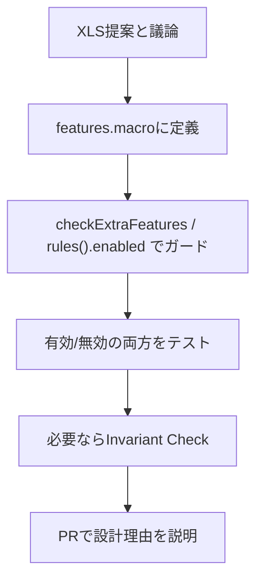

XRPL は世界中の独立したノードが同じルールで動くことで成り立っています。新しい機能を勝手に有効化すると、古いノードと新しいノードでトランザクション結果が食い違う可能性があります。これを防ぐのが **アメンドメント** です。

::::note[仕組みを復習する場合]
アメンドメントの有効化プロセスやLedger上の管理方法を先に確認したい場合は、Level 4 の [アメンドメントの仕組み](/xrpld/level4/amendments/) を参照してください。このページでは、実装時にどこへ定義し、どこでガードするかに絞って見ます。
::::

## なぜ新機能はアメンドメントで守るのか

挙動を変える変更をアメンドメントなしで入れると、新しいコードのノードと古いコードのノードで結果が食い違い、コンセンサスが取れなくなる可能性があります。アメンドメントで囲むことで、次の状態を作れます。

- 過半数のバリデータが賛成するまで機能は無効のまま
- 有効化条件を満たした後、全ノードが同じルールで新しい挙動へ進む

::::caution[無効側の挙動を変えない]
アメンドメントが無効な状態では、導入前と同じ結果を返す必要があります。無効側で少しでも挙動が変わると、有効化前のネットワークで分岐を起こす可能性があります。
::::

## ステップ1: features.macroに定義する

アメンドメントは `features.macro` に定義します。

```
include/xrpl/protocol/detail/features.macro
include/xrpl/protocol/Feature.h
```

定義は `XRPL_FEATURE` または `XRPL_FIX` マクロで行われます。

```cpp
XRPL_FEATURE(MyNewFeature, Supported::Yes, VoteBehavior::DefaultNo)
```

| 引数 | 設定の目安 |
|------|------------|
| `Supported::Yes` | このビルドが機能を実装済みなら `Yes` |
| `VoteBehavior::DefaultNo` | 新機能は慎重に既定で反対票から始める |

この定義から、`featureMyNewFeature` のような定数が生成されます。

## ステップ2: コードにガードを置く

機能を変更するコードでは、`rules().enabled(...)` でアメンドメントの有効/無効を見ます。

```cpp
if (ctx_.view().rules().enabled(featureMyNewFeature))
{
    // アメンドメントが有効なときだけ通る新しい挙動
}
```

新しいトランザクションタイプ全体をアメンドメントで無効化する場合は、`checkExtraFeatures()` を定義します。`Transactor` の共通処理がこれを呼び、機能が無効なら `temDISABLED` として扱います。

```cpp
static bool
MyTransactor::checkExtraFeatures(PreflightContext const& ctx)
{
    return ctx.rules.enabled(featureMyNewFeature);
}
```

実例として `LoanBrokerSet` では、Lending Protocol 関連の依存アメンドメントを `checkExtraFeatures()` でまとめて確認しています。ここでは Lending の仕様を追うより、「機能が有効なときだけ受け付ける判定を共通ヘルパーへ寄せている」点に注目してください。

```cpp
// src/libxrpl/tx/transactors/lending/LoanBrokerSet.cpp
bool
LoanBrokerSet::checkExtraFeatures(PreflightContext const& ctx)
{
    return checkLendingProtocolDependencies(ctx.rules, ctx.tx);
}
```

既存トランザクションの一部挙動だけを変える場合は、`doApply()` など実際に分岐が必要な場所で `ctx_.view().rules().enabled(...)` を見ます。どの段階で拒否または分岐するかは、トランザクションの意味と既存挙動への影響で決めます。

## ステップ3: 有効・無効の両方でテストする

アメンドメント付きの変更では、有効なケースだけでなく、無効なケースもテストします。

```cpp
void
run() override
{
    using namespace test::jtx;
    FeatureBitset const all{testableAmendments()};

    testWithFeats(all);
    testWithFeats(all - featureMyNewFeature);
}
```

| パターン | 確認したいこと |
|----------|----------------|
| `all` | 新機能が有効なときに正しく動く |
| `all - featureMyNewFeature` | 機能無効時に従来の挙動を保つ、または `temDISABLED` で拒否する |

## ステップ4: Invariant Checkを検討する

新機能がLedgerの状態を新しく作る、残高に影響する、所有関係を持つオブジェクトを追加する、といった場合は Invariant Check を検討します。

```
include/xrpl/tx/invariants/InvariantCheck.h
src/libxrpl/tx/invariants/
src/libxrpl/tx/Transactor.cpp
```

Invariant Checkは、個々のTransactorにバグがあってもLedgerが壊れた状態で確定しないようにする最後の検査です。

## 全体の流れ



## 次のステップ

次は [Invariant Checksの仕組み](/xrpld/level6/invariants/) に進み、トランザクション適用後にLedgerの整合性をどう守るかを見ます。
