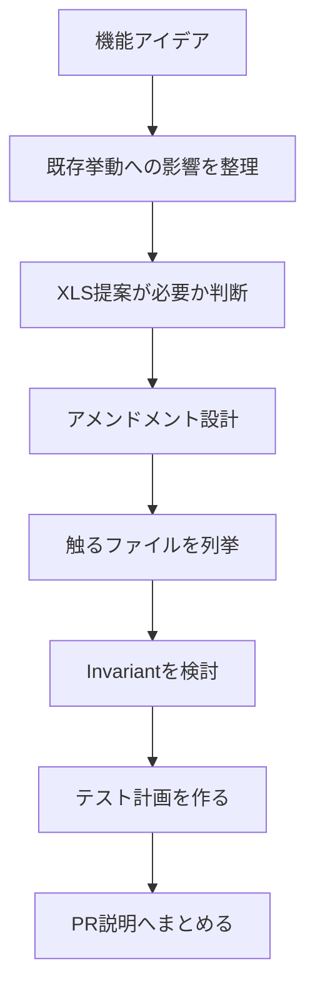

Level 6の総合演習では、実装そのものよりも「設計判断を説明できること」を重視します。新しいトランザクションタイプやLedger機能は、コード差分だけではレビューできません。なぜ必要か、既存挙動をどう守るか、どの条件をテストするかを説明する必要があります。

## 演習のゴール

この演習のゴールは、架空の新機能を題材に、PRへ進む前の設計メモを作れるようになることです。実際に大きな機能をいきなり実装する必要はありません。



## 1. 変更の種類を分類する

まず、その変更がどの種類かを分類します。

| 変更 | 例 | 注意点 |
|------|----|--------|
| テスト追加 | 既存挙動のカバレッジ追加 | 初心者のPRに向いている |
| バグ修正 | 明確な再現手順がある失敗の修正 | 既存挙動の変更か確認する |
| 新しい挙動 | 新トランザクション、新フィールド | XLSとアメンドメントを検討する |
| Ledger構造変更 | 新しいLedgerエントリ | Invariantと移行を検討する |

Level 5で行った `SetRegularKey` のローカル実験は「新しい挙動」に近い変更でした。だからこそ、そのままPR候補にはせず、テスト追加だけに整理しました。

## 2. 触るファイルを列挙する

新しいトランザクションタイプを想定するなら、最低限次を確認します。

```
include/xrpl/protocol/detail/transactions.macro
include/xrpl/protocol/detail/sfields.macro
include/xrpl/protocol/detail/features.macro
include/xrpl/tx/transactors/
src/libxrpl/tx/transactors/
include/xrpl/tx/invariants/InvariantCheck.h
src/libxrpl/tx/invariants/
src/test/app/
```

この一覧をPR説明や設計メモに書けると、レビュアーは影響範囲を把握しやすくなります。

## 3. アメンドメント方針を書く

挙動変更を伴うなら、アメンドメント方針を明記します。

```text
This change is guarded by featureExampleFeature.

When the amendment is disabled, the transaction preserves the existing
behavior and returns the same TER codes as before.

When the amendment is enabled, the new field is accepted and processed
by ExampleTransactor.
```

重要なのは、有効時だけでなく無効時の挙動を書くことです。

## 4. Invariant方針を書く

新しいLedger状態を作るなら、Invariantが必要かを検討します。

```text
Invariant considerations:

- The new ledger entry must not be left without an owner.
- The total amount represented by the entry must not increase as a
  side effect of unrelated transactions.
- Deleting the owner account must not leave orphaned entries.
```

この時点で実装できていなくても、何を守るべきか言語化することが重要です。

## 5. テスト計画を書く

アメンドメント付きの変更なら、テスト計画には有効・無効の両方を入れます。

```text
Test plan:

- Amendment disabled: the new transaction is rejected with temDISABLED.
- Amendment enabled: the transaction succeeds with valid fields.
- Invalid field combinations return temMALFORMED.
- Ledger state is updated as expected.
- Invariant failure cases are covered where practical.
```

テスト計画は、実装後にそのままチェックリストとして使えます。

## 6. PR説明の型

本格的な変更のPR説明は、次の構造にすると読みやすくなります。

```text
Summary

- Add ExampleTransaction behind featureExampleFeature.
- Define the new transaction format and Transactor implementation.
- Add amendment-enabled and amendment-disabled tests.

Design notes

- The amendment is required because this changes transaction acceptance.
- Amendment-disabled behavior is preserved.
- No new ledger entry is introduced, so no new invariant is required.

Test plan

- ./xrpld --unittest ExampleTransaction
- ./xrpld --unittest --unittest-match "Example"
```

## Level 6のまとめ

Level 6では、次を学びました。

- 新しいトランザクションタイプを追加するときに触るファイル
- アメンドメントで新機能を守る理由
- Invariant CheckでLedgerの整合性を最後に守る考え方
- 設計判断をPR説明へ落とし込む方法

ここまで進めば、いきなり大きな機能を実装しなくても、`xrpld` の設計議論を読み、質問し、小さなPRから段階的に貢献していく準備が整っています。
