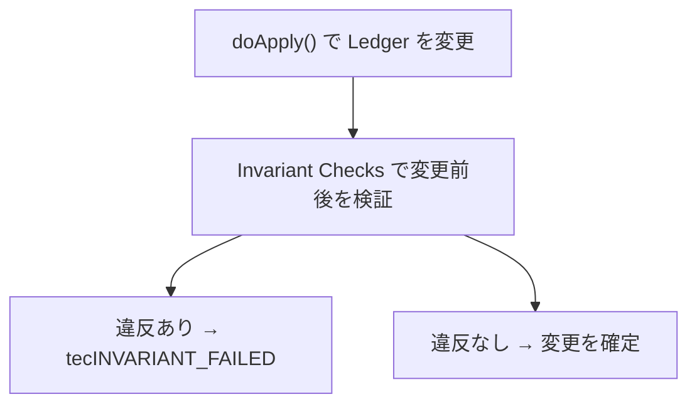

Invariant Check は、トランザクション適用の結果が、絶対に破ってはいけないルールに違反していないかを最後に検証する仕組みです。新しいトランザクションやLedgerオブジェクトを追加するときは、この仕組みを必ず意識します。

## Invariant Checkとは

各Transactorの `doApply()` はLedgerを変更します。その後、変更前後のLedgerエントリを見て、Invariant Checkが整合性を検証します。



たとえば「XRPの総量は決して増えない」「アカウントのXRP残高が不正な値にならない」といった、XRPLの根幹をなす条件があります。Transactorの実装にバグがあっても、Invariant Checkが最後に検出できれば、壊れたLedger状態を確定させずに済みます。

## 実装の場所

主な定義と実装は次にあります。

```
include/xrpl/tx/invariants/InvariantCheck.h
src/libxrpl/tx/invariants/InvariantCheck.cpp
src/libxrpl/tx/invariants/AMMInvariant.cpp
src/libxrpl/tx/invariants/NFTInvariant.cpp
src/libxrpl/tx/Transactor.cpp
```

代表的なチェックには、次のようなものがあります。

| チェック | 保証する条件 |
|----------|--------------|
| `XRPNotCreated` | XRPの総量が増えていない |
| `XRPBalanceChecks` | XRP残高が不正な値になっていない |
| `AccountRootsNotDeleted` | アカウントが不正に削除されていない |
| `LedgerEntryTypesMatch` | Ledgerエントリの型が変わっていない |
| `TransactionFeeCheck` | 手数料の扱いが正しい |
| `NoXRPTrustLines` | XRPのトラストラインが作られていない |

これらに加えて、AMM、NFT、MPTのような機能専用のInvariantもあります。

## 2つのメソッド

Invariant Checkは、変更されたLedgerエントリを順番に見て、最後に判定します。`InvariantCheck.h` には、各チェックが実装すべき形が示されています。

```cpp
class SomeInvariant
{
public:
    void
    visitEntry(bool isDelete, SLE::const_ref before, SLE::const_ref after);

    bool
    finalize(
        STTx const& tx,
        TER const result,
        XRPAmount const fee,
        ReadView const& view,
        beast::Journal const& j) const;
};
```

| メソッド | 役割 |
|----------|------|
| `visitEntry` | 変更されたSLEごとに呼ばれ、変更前と変更後を観測して状態を蓄積する |
| `finalize` | すべての訪問後に、不変条件が守られているか最終判定する |

`finalize()` が `false` を返すと、Invariant違反としてトランザクションは失敗します。

## 新機能で検討すること

新しい機能を追加するときは、次の観点でInvariantが必要か考えます。

- 新しいLedgerエントリ型を作るか
- 残高、発行量、所有数の合計が意味を持つか
- 削除してはいけないオブジェクトがあるか
- Transactor単体の検証だけでは守りきれない条件があるか
- 複数のトランザクション種別から同じ状態を変更するか

Invariant Checkは、個々のTransactorの正しさを信じるためではなく、結果としてLedgerが守るべき条件を独立に確認するためのものです。

## 読む練習

まずは、次の順番で読むと全体像をつかみやすいです。

1. `include/xrpl/tx/invariants/InvariantCheck.h` でチェックの一覧を見る
2. `src/libxrpl/tx/invariants/InvariantCheck.cpp` で代表的なチェックを読む
3. `src/libxrpl/tx/Transactor.cpp` でInvariantがいつ呼ばれるかを追う
4. 機能専用の `AMMInvariant.cpp` や `NFTInvariant.cpp` を1つ選んで読む

## 次のステップ

最後に、[総合演習：設計判断を含むPRへ進む](/xrpld/level6/capstone/) で、新機能の設計をレビュー可能な説明へまとめます。
