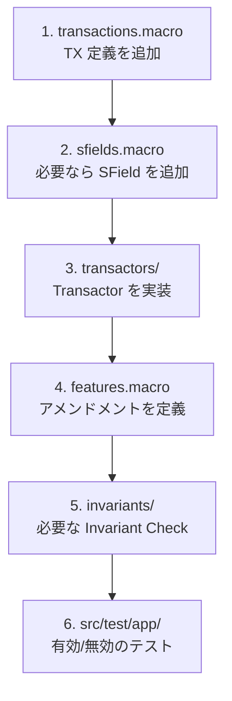

新しいトランザクションタイプの追加は、`xrpld` コントリビューションの中でも難易度の高いテーマです。実際に取り組むには XLS 提案やアメンドメントの合意が必要ですが、ここでは**コードのどこに何を追加するのか**という全体像を理解することを目標にします。

::::caution[実際の追加にはプロセスが必要]
新しいトランザクションタイプは XRPL のプロトコル変更にあたります。コードを書く前に [XLS 標準](https://github.com/XRPLF/XRPL-Standards) として提案し、コミュニティの合意を得る必要があります。
::::

## トランザクション定義の中心

トランザクションタイプは `TRANSACTION` マクロで定義され、そこから `TxFormats` や Transactor ファクトリ用のコードが生成されます。

```
include/xrpl/protocol/detail/transactions.macro
include/xrpl/protocol/TxFormats.h
```

たとえば `Payment` は次のように定義されています。

```cpp
TRANSACTION(ttPAYMENT, 0, Payment,
    Delegation::Delegable,
    uint256{},
    CreateAcct | MayCreateMpt,
    ({
    {sfDestination, SoeRequired},
    {sfAmount, SoeRequired, SoeMptSupported},
    {sfSendMax, SoeOptional, SoeMptSupported},
    {sfPaths, SoeDefault},
    {sfInvoiceID, SoeOptional},
    {sfDestinationTag, SoeOptional},
    {sfDeliverMin, SoeOptional, SoeMptSupported},
    {sfCredentialIDs, SoeOptional},
    {sfDomainID, SoeOptional},
}))
```

この1つの定義に、数値ID、名前、必要なアメンドメント、権限、フィールド一覧がまとまっています。

| 要素 | 意味 |
|------|------|
| `ttPAYMENT` | トランザクションタイプのタグ |
| `0` | オンザワイヤで使われる数値ID |
| `Payment` | 対応するTransactorクラス名 |
| `uint256{}` | 必要なアメンドメント。なければ空 |
| `CreateAcct | MayCreateMpt` | Invariant Checkで参照される特権 |
| フィールド群 | `sfXxx` と必須/任意の指定 |

## Transactorを実装する

定義に対応する処理ロジックは、`Transactor` を継承したクラスとして実装します。宣言は `include/xrpl/tx/transactors/`、実装は `src/libxrpl/tx/transactors/` に置かれます。

```
include/xrpl/tx/Transactor.h
src/libxrpl/tx/Transactor.cpp
include/xrpl/tx/transactors/
src/libxrpl/tx/transactors/
```

典型的には、次の処理を実装または確認します。

```cpp
class SomeTransactor : public Transactor
{
public:
    explicit SomeTransactor(ApplyContext& ctx) : Transactor(ctx)
    {
    }

    static NotTEC preflight(PreflightContext const& ctx);

    // 必要な場合だけ定義する。多くのTransactorは基底実装を使う。
    static TER preclaim(PreclaimContext const& ctx);

    TER doApply() override;

    void
    visitInvariantEntry(bool isDelete, SLE::const_ref before, SLE::const_ref after) override;

    [[nodiscard]] bool
    finalizeInvariants(
        STTx const& tx,
        TER result,
        XRPAmount fee,
        ReadView const& view,
        beast::Journal const& j) override;
};
```

`preflight()` はトランザクション自体の静的検証、`preclaim()` はLedgerを参照した追加検証、`doApply()` はLedger更新です。`preclaim()` は必要な場合だけ定義し、不要なら `Transactor` の既定実装を使います。

現在の `Transactor` は、トランザクション固有のInvariant用フックとして `visitInvariantEntry()` と `finalizeInvariants()` も要求します。まだ独自Invariantがない場合でも、既存の小さなTransactorのように何もせず `true` を返す実装を置きます。

### 実例: LoanBrokerSet

実際のヘッダを見るなら、`LoanBrokerSet` がよい例です。ここでは Lending Protocol の詳細を理解する必要はありません。まずは `preflight()`、`preclaim()`、`doApply()` に加えて、アメンドメント確認用の `checkExtraFeatures()`、補助的なフィールド定義を返す `getValueFields()`、Invariant用フックがどのように並んでいるかを見ます。

```cpp
// include/xrpl/tx/transactors/lending/LoanBrokerSet.h
class LoanBrokerSet : public Transactor
{
public:
    static constexpr auto kConsequencesFactory = ConsequencesFactoryType::Normal;

    explicit LoanBrokerSet(ApplyContext& ctx) : Transactor(ctx)
    {
    }

    static bool
    checkExtraFeatures(PreflightContext const& ctx);

    static NotTEC
    preflight(PreflightContext const& ctx);

    static std::vector<OptionaledField<STNumber>> const&
    getValueFields();

    static TER
    preclaim(PreclaimContext const& ctx);

    TER
    doApply() override;

    void
    visitInvariantEntry(bool isDelete, SLE::const_ref before, SLE::const_ref after) override;

    [[nodiscard]] bool
    finalizeInvariants(
        STTx const& tx,
        TER result,
        XRPAmount fee,
        ReadView const& view,
        beast::Journal const& j) override;
};
```

このように、実際のTransactorは「3段階検証」だけでなく、TxQへの影響、アメンドメント、Invariantまで含めて読むと全体像をつかみやすくなります。

## 追加時に触る代表的な箇所

新しいトランザクションタイプを1つ追加するとき、典型的に触るのは次の場所です。



::::tip[まず既存トランザクションを通して読む]
いきなり新規作成せず、`SetRegularKey`、`AccountSet`、`TicketCreate` のような比較的小さい既存トランザクションを「定義 → Transactor → テスト」の順に読むと、追加時に必要な作業が見えやすくなります。
::::

## 次のステップ

新しいトランザクションタイプの追加は、多くの場合アメンドメントで保護する必要があります。次は [アメンドメントを定義して機能を追加する](/xrpld/level6/amendment-dev/) に進みます。
